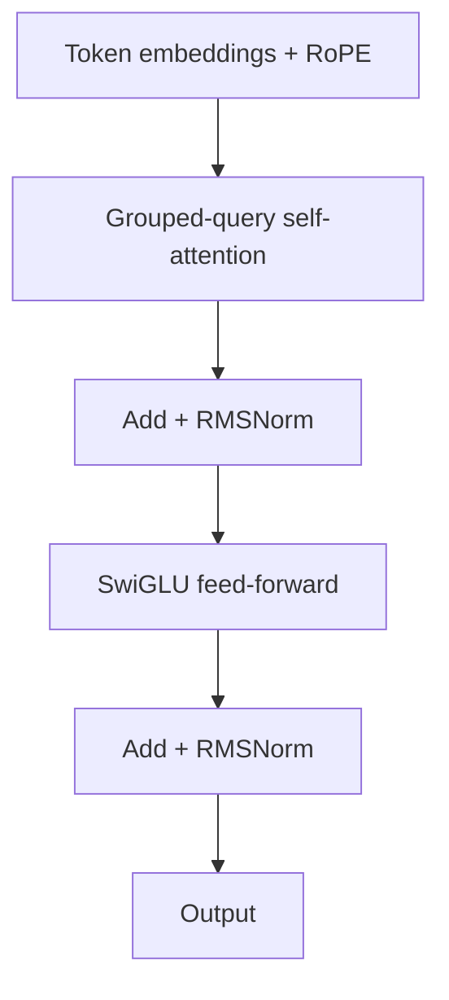

# Transformers Deep Dive

> **Level:** BEG · **Last verified:** 2026-10-20 · **Sources:** [Attention Is All You Need](https://arxiv.org/abs/1706.03762), [FlashAttention-2](https://arxiv.org/abs/2307.08691), [DeepSeek-V2 (MLA)](https://arxiv.org/abs/2405.04434)

## Why this matters

Every frontier model you'll touch in 2026 — GPT-6, Claude 5.5, Gemini 3.x, Llama 4, DeepSeek V4 — is a transformer. You don't need to implement one from scratch, but you need enough mental model to reason about context windows, KV-cache, MoE, and why inference is expensive. At the staff-engineer level this means more than knowing "attention is O(n²)": it means being able to compute, from a model's config, how many GB of KV-cache a 128K-context request needs, whether decode is compute- or bandwidth-bound on your GPU, and why one architecture serves 10× cheaper than another.

## Core concepts

### The transformer block



Three operations dominate:
1. **Attention** — every token looks at every other token. O(n²) in sequence length.
2. **Feed-forward** — per-token MLP. The "knowledge" lives here; it holds ~2/3 of the parameters in a dense model.
3. **Residual + normalization** — keeps gradients flowing.

Four details separate the 2017 original from what production models run in 2026, and each exists for a measurable reason:

- **Pre-norm, not post-norm.** The original paper applied LayerNorm after the sublayer (post-norm). Modern models normalize *before* (pre-norm; formalized in [Xiong et al. 2020](https://arxiv.org/abs/2002.04745)). Pre-norm removes the large-gradient regime at initialization, so deep transformers train without learning-rate warm-up gymnastics. The cost: effective depth shrinks slightly, which nobody misses.
- **RMSNorm, not LayerNorm.** Llama-family and most open models use RMSNorm ([Zhang & Sennrich 2019](https://arxiv.org/abs/1910.07467)) — it drops the mean-centering, keeping only the RMS scaling. Same quality, ~7-64% faster normalization depending on shape, and no biased statistics to track in kernels.
- **SwiGLU activations.** The FFN is gated: `FFN(x) = W_down(SiLU(W_gate(x)) ⊙ W_up(x))` ([Shazeer 2020](https://arxiv.org/abs/2002.05202)). Gated units beat GELU/ReLU MLPs at equal parameter count, at the price of a third weight matrix — which is why SwiGLU models typically size the FFN at ~8/3·d instead of the classic 4·d (same parameter budget, three matrices instead of two).
- **RoPE position embeddings.** Rotatory embeddings ([Su et al.](https://arxiv.org/abs/2104.09864)) rotate Q and K by position-dependent angles so attention scores depend on *relative* offsets. Absolute learned positions died with GPT-2. RoPE is the detail that matters when serving stacks extend context: YaRN-style scaling selectively rescales the rotation frequencies for high-frequency components rather than stretching everything.

### Attention variants you'll actually meet (2026)

The textbook multi-head attention (MHA) above is no longer what production models run. Three variants matter because they shrink the KV-cache (see `02-kv-cache-and-inference.md`):

- **GQA (grouped-query attention)** — many query heads share a few KV heads ([Ainslie et al. 2023](https://arxiv.org/abs/2305.13245)). Llama 3/4 and Qwen run 32-64 query heads against 4-8 KV heads → 4-8× smaller KV-cache with near-zero quality loss. This is the default in every serious open model.
- **MLA (multi-head latent attention)** — DeepSeek's latent compression of KV (V3/V4 lines, introduced in [DeepSeek-V2](https://arxiv.org/abs/2405.04434)). K and V are projected into a small joint latent vector (e.g. 512-d against thousands of dims of full KV); during decode only the latent and a decoupled RoPE key are cached. The DeepSeek-V2 paper reports a **93.3% KV-cache reduction and 5.76× maximum generation throughput** vs its MHA-equivalent baseline — the structural reason DeepSeek serves so cheaply.
- **Sliding-window / hybrid attention** — attention restricted to a local window for long contexts (Gemma, some open models). Pure sliding window breaks long-range recall, so production models interleave layers: Gemma 2 alternates 1 local (4096-token window) : 1 global in the 2B/9B models and 5:1 in the 27B. You trade exact global attention at every layer for an O(n·w) complexity that actually fits the context you advertise.

### Attention in one line

```text
attention(Q, K, V) = softmax(Q·Kᵀ / sqrt(d_k)) · V
```

The `sqrt(d_k)` is not cosmetic: dot products of d_k-dimensional random vectors have variance d_k, and unscaled scores push softmax into saturation (gradients → 0). FlashAttention ([Dao et al. 2022](https://arxiv.org/abs/2205.14135), [FA-2 2023](https://arxiv.org/abs/2307.08691)) computes the *exact same* result — it is not an approximation — by tiling Q/K/V through SRAM and never materializing the n² score matrix in HBM. It turns attention from a memory-traffic problem into a compute problem; that single kernel change is worth 2-4× end-to-end speedups at long context.

### The two-phase inference cost

This is the part most tutorials skip:

| Phase | What happens | Cost shape |
|-------|--------------|------------|
| **Prefill** | Process the prompt; fill KV-cache | Compute-bound; parallel over all prompt tokens |
| **Decode** | Generate one token at a time; read the whole KV-cache per step | Memory-bandwidth-bound; sequential |

The arithmetic you should be able to do on a whiteboard:

- **Prefill FLOPs ≈ 2 · N_params · N_prompt_tokens** (multiply + add per weight per token). An 8B model on a 16K prompt ≈ 2·8e9·16e3 = 2.6e14 FLOP — about 0.26 s of an H100 SXM's ~1000 TFLOP/s bf16, before efficiency losses.
- **Decode is bandwidth-bound.** Each generated token must stream the entire (active) weight matrix once: bytes moved ≈ 2·N_params (bf16). Ceiling for single-sequence decode ≈ HBM_bandwidth / model_bytes. H100 SXM: ~3.35 TB/s ÷ 16 GB (8B bf16) ≈ **~200 tok/s theoretical**, ~100-140 realistic. This is why decode throughput scales with batching (amortize the same weight-read across sequences) and why speculative decoding exists.
- **KV-cache bytes per token = 2 · n_kv_heads · d_head · dtype_bytes · n_layers.** The classic mistake is forgetting the layer count. Per layer, Llama-3.1-8B (8 KV heads, d_head 128, bf16) needs 2·8·128·2 = 4 KB/token; across 32 layers that is **128 KB/token model-wide** → a 128K context costs **~16.8 GB per sequence** — a fifth of an 80 GB H100 before you've loaded the 16 GB of weights. And against a hypothetical 32-KV-head MHA version the same request would need 4× more (67 GB): GQA is the only reason 128K contexts are servable at all on that architecture. MoE and MLA are both, at bottom, attacks on this arithmetic.

Decode is why token generation is slow. The KV-cache is what makes it bearable. PagedAttention ([vLLM, Kwon et al. 2023](https://arxiv.org/abs/2309.06180)) — KV-cache stored in fixed-size blocks with a page table, like OS virtual memory — cut cache fragmentation waste from ~60-80% (reserve-max) to <4% and is why serving stacks quote throughput in the tens of thousands of tokens/s.

## Code: minimal attention

```python
import torch
import torch.nn.functional as F

def attention(Q, K, V, mask=None):
    # Q, K, V: (batch, heads, seq, d_head)
    d_k = Q.size(-1)
    scores = Q @ K.transpose(-2, -1) / d_k ** 0.5
    if mask is not None:
        scores = scores.masked_fill(mask == 0, float('-inf'))
    weights = F.softmax(scores, dim=-1)
    return weights @ V
```

In production you do not ship this — `torch.nn.functional.scaled_dot_product_attention` dispatches to FlashAttention/cuDNN kernels. Its value is as a reference implementation to read.

## Code: KV-cache calculator

The tool that turns this note into decisions. Given any model config, compute cache cost per sequence before you commit to a context length:

```python
def kv_cache_gb(n_kv_heads: int, d_head: int, ctx_len: int,
                dtype_bytes: int = 2, layers: int = 32) -> float:
    """KV-cache size for one sequence. 2 = K and V."""
    bytes_per_token = 2 * n_kv_heads * d_head * dtype_bytes * layers
    return bytes_per_token * ctx_len / 1e9

# Llama-3.1-8B (32 layers, 8 KV heads, d_head=128), bf16, 128K context:
print(f"{kv_cache_gb(8, 128, 128_000, layers=32):.2f} GB")   # -> 16.78 GB

# Same model, 1M context (Llama 4 Scout-class):
print(f"{kv_cache_gb(8, 128, 1_000_000, layers=32):.2f} GB")  # -> 131.07 GB — needs
# quantized KV-cache + tensor-parallel sharding across GPUs to fit
```

Multiply by batch size, then check against `total_gpu_memory − weights − activations`. When the answer doesn't fit, the fixes in order of preference: GQA/MLA architecture (build time), quantized KV-cache (fp8 KV = 2×, quality-neutral for most workloads), PagedAttention (serving time), or shorter context via RAG (design time).

## Production concerns

- **Latency:** Prefill is parallel; decode is sequential. A 1M-token prompt takes seconds to prefill even on H100s; serving stacks use *chunked prefill* to slice long prompts so a 1M-token prefill doesn't stall every other tenant's token stream, and *prefill/decode disaggregation* to run the phases on different GPU pools.
- **Cost:** APIs bill separately for input (prefill) and output (decode) tokens. Output is usually 3-5× more expensive per token — it's bandwidth-bound work you're renting at compute prices.
- **Speculative decoding:** draft with a small model, verify the draft in one parallel prefill-style pass with the target model ([Leviathan et al. 2023](https://arxiv.org/abs/2211.17192)). Accept-if-probability-matches makes the output distribution identical to the target model's; 2-3× decode speedups on accepted-heavy workloads (code, extractive tasks) and near-zero on high-entropy text. It's the standard trick behind "fast mode" toggles in 2026 APIs.
- **Failure modes:** "Lost in the middle" ([Liu et al. 2023](https://arxiv.org/abs/2307.03172)) — models attend less well to tokens in the middle of long contexts. U-shaped recall is why "just use 1M context" underperforms RAG for needle-in-haystack recall at scale.
- **Security:** Prompt injection works because attention has no concept of "trusted" vs "untrusted" tokens — every token in the window is first-class input to every head.

## Anti-patterns

- ❌ **Treating context window as free.** Doubling context does not double cost; attention prefill work grows quadratically, and KV-cache grows linearly per sequence.
- ❌ **Assuming bigger context = better recall.** Empirically false past ~64K without retrieval; "lost in the middle" degrades mid-context recall even when the window technically fits.
- ❌ **Ignoring KV-cache economics.** A 128K context can blow your GPU memory budget on the cache alone (see the calculator above).
- ❌ **Benchmarking with short prompts.** A model that hits 150 tok/s at 2K context may deliver <40 tok/s at 128K — the attention kernel and KV reads both scale with history. Always benchmark at your p95 production context length.

## Decision framework

If you're picking a model for a task:
- Long input + short output → favor cheap-input models (Gemini Flash-Lite, DeepSeek).
- Short input + long output → favor cheap-output models (GPT-6 Luna, Claude Haiku 5.5), and check whether the provider offers speculative decoding.
- Both long → use prompt caching aggressively; the cache is the provider reusing your prefill.
- Serving the model yourself → the config decides your economics: GQA ratio or MLA sets KV-cache cost, and active-parameter count (dense N vs MoE active) sets decode bandwidth per token. Run the numbers before the cluster order.

## References

- [Attention Is All You Need](https://arxiv.org/abs/1706.03762) — verified 2026-10-20
- [The Illustrated Transformer — Jay Alammar](http://jalammar.github.io/illustrated-transformer/) — verified 2026-10-20
- [The Illustrated GPT-2 — Jay Alammar](https://jalammar.github.io/illustrated-gpt2/) — verified 2026-10-20
- [FlashAttention-2](https://arxiv.org/abs/2307.08691) — verified 2026-10-20
- [DeepSeek-V2 (MLA)](https://arxiv.org/abs/2405.04434) — verified 2026-10-20
- [GQA](https://arxiv.org/abs/2305.13245) — verified 2026-10-20
- [Efficient Memory Management for LLM Serving (PagedAttention)](https://arxiv.org/abs/2309.06180) — verified 2026-10-20
- [Fast Inference from Transformers via Speculative Decoding](https://arxiv.org/abs/2211.17192) — verified 2026-10-20
