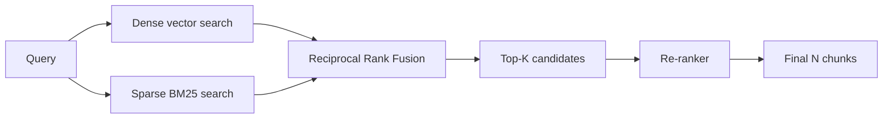

# Hybrid Search

> **Level:** INT · **Last verified:** 2026-10-20 · **Sources:** [RRF (Cormack et al., SIGIR 2009)](https://plg.uwaterloo.ca/~gvcormac/cormacksigir09-rrf.pdf), [pgvector](https://github.com/pgvector/pgvector)

## Why this matters

Pure vector search misses exact-match queries (product codes, error messages, names). Pure keyword search misses semantic matches. Hybrid search blends both and beats either alone by 10–30% on most benchmarks. The expert view: dense and sparse retrieval fail *orthogonally* — their error sets barely overlap — which is why fusion is so reliably positive, and also why you can diagnose which retriever is failing from which queries miss.

## Core concepts

### The two retrievers — and their failure sets

- **Dense (vector)** — semantic; "how do I cancel my plan" matches "subscription termination". Fails on: out-of-vocabulary identifiers (`ERR_CONN_REFUSED_4421`), rare named entities the embedder never saw in contrastive training, negation ("plans that do NOT include X"), and exact numbers/versions.
- **Sparse (BM25 / SPLADE)** — lexical; exact-string matching with IDF weighting. Fails on: synonyms, paraphrase, cross-lingual, and vocabulary mismatch between user phrasing and doc phrasing.

The orthogonality is the whole point: when BM25's exact-match strength and dense's semantic strength are fused, a chunk needs to look good to *at least one* system to surface. Hybrid recall is close to the union of both retrievers' recall.

### BM25 mechanics (what you're actually tuning)

BM25 scores a term by IDF × saturation-weighted TF, with `k1` controlling term-frequency saturation and `b` controlling length normalization. Defaults `k1=1.2, b=0.75` are robust; if you tune anything, tune `b` down (0.4–0.6) when your corpus has heavy-length skew (some 50-token chunks, some 5,000-token chunks), because high `b` over-penalizes long chunks. In Postgres FTS, the analog is the ranking function choice (`ts_rank` vs `ts_rank_cd` — cover density rewards adjacent query terms, usually better for phrase-like queries).

### SPLADE — learned sparse, the middle path

SPLADE models produce *sparse vectors over the vocabulary* with learned term expansion: the query "car" gets non-zero weights on "vehicle", "automobile", "sedan". You get BM25's exact-match behavior plus a learned synonym map, in the same inverted-index infrastructure. BGE-M3 emits sparse weights natively alongside dense vectors (arXiv 2402.03216), so one embed pass gives you both halves of hybrid without a separate BM25 pipeline. Trade-off: SPLADE vectors are model-version-locked (a model swap re-indexes, unlike BM25), and per-query latency is higher than raw BM25.

### The fusion

1. **Score fusion** — normalize scores from each retriever (min-max or z-score per result set), weight, sum. Fragile: requires score distributions to be comparable, and the optimal weight drifts with corpus and query mix. Tune it on a held-out set or skip it.
2. **Reciprocal Rank Fusion (RRF)** — `score = Σ 1/(k + rank_i)` per retriever. Robust to scale differences because it uses *ranks*, not scores; `k=60` is the standard from the original paper. RRF's indifference to score distributions is why it's the default in every hybrid-search engine (Weaviate, OpenSearch, Postgres recipes).

The expert question: *why* k=60? It flattens the head of the reciprocal curve so rank-1 vs rank-2 differ by ~1/61 vs 1/62 — the fusion is gentle to both retrievers' top results, letting strong signals from either side win while neither dominates. Small k (≈10) sharpens competition for top ranks; large k (≈100) approaches uniform averaging of rank lists.

### Query understanding before the retrievers

Hybrid search fixes *retrieval* failures, not *query* failures. A query in the wrong language, a question that names the wrong entity, or a two-part question ("compare pricing of A and B") needs decomposition before retrieval. This is where the boundary with agentic RAG sits (`05-agentic-rag.md`): the agent decides *what queries to issue*; hybrid search answers each one well.

### Hybrid in one diagram



## Code: hybrid with pgvector + BM25

```python
import psycopg2

def hybrid_search(conn, query_text, query_embedding, k=20):
    with conn.cursor() as cur:
        cur.execute('''
            WITH dense AS (
                SELECT id, content, row_number() OVER (ORDER BY embedding <=> %s) AS rank
                FROM docs
                ORDER BY embedding <=> %s
                LIMIT %s
            ),
            sparse AS (
                SELECT id, content, row_number() OVER (ORDER BY ts_rank(content_tsvector, plainto_tsquery('english', %s)) DESC) AS rank
                FROM docs
                ORDER BY ts_rank(content_tsvector, plainto_tsquery('english', %s)) DESC
                LIMIT %s
            )
            SELECT COALESCE(dense.id, sparse.id) AS id,
                   COALESCE(dense.content, sparse.content) AS content,
                   COALESCE(1.0/(60 + dense.rank), 0) + COALESCE(1.0/(60 + sparse.rank), 0) AS score
            FROM dense FULL OUTER JOIN sparse USING (id)
            ORDER BY score DESC
            LIMIT %s
        ''', (query_embedding, query_embedding, k, query_text, query_text, k, k))
        return cur.fetchall()
```

The FULL OUTER JOIN is the SQL embodiment of the union-recall property: a chunk found by only one retriever still enters fusion (with rank 0 contribution from the other side via COALESCE).

## Production concerns

- **Latency:** Two retrievals in parallel adds ~1x latency (not 2x if parallelized — issue both, await both). The re-ranker after fusion (below) dominates the latency budget.
- **Cost:** Self-hosted BM25 is essentially free; dense retrieval is the cost center (embedding calls + vector index maintenance).
- **Failure modes:** (1) RRF weight tuning is corpus-dependent — don't copy-paste tuned weights between corpora; (2) BM25 language configs — `plainto_tsquery('english', ...)` on non-English text silently degrades stemming; (3) stale tsvector columns after bulk inserts — keep the GIN index updated or searches return nothing new.
- **Security:** BM25 indexes can leak term frequencies (a classic timing/traffic-analysis side channel for multi-tenant corpuses — tenant-shared indexes reveal co-tenant vocabulary). Partition indexes by tenant for sensitive deployments.
- **Eval:** Track recall@k for dense, sparse, and hybrid *separately*. When hybrid regresses, the per-retriever metrics tell you which half broke. The orthogonality that makes hybrid work also makes its failures decomposable.

## Anti-patterns

- ❌ **Dense-only retrieval for code or product catalogs.** Exact match matters.
- ❌ **Sparse-only for chat logs.** Synonyms matter.
- ❌ **Weighted score fusion without normalization.** Comparing apples to oranges.
- ❌ **Tuning fusion weights without a held-out set.** You'll fit noise.
- ❌ **Skipping the re-ranker because hybrid "already works."** Fusion fixes recall; precision still needs the cross-encoder (`04-reranking.md`).

## References

- [Reciprocal Rank Fusion paper](https://plg.uwaterloo.ca/~gvcormac/cormacksigir09-rrf.pdf) — verified 2026-10-20
- [pgvector hybrid search](https://github.com/pgvector/pgvector#hybrid-search) — verified 2026-10-20
- [Weaviate: Hybrid search explained](https://weaviate.io/blog/hybrid-search-explained) — verified 2026-10-20
- [M3-Embedding (BGE-M3, dense+sparse)](https://arxiv.org/abs/2402.03216) — verified 2026-10-20
