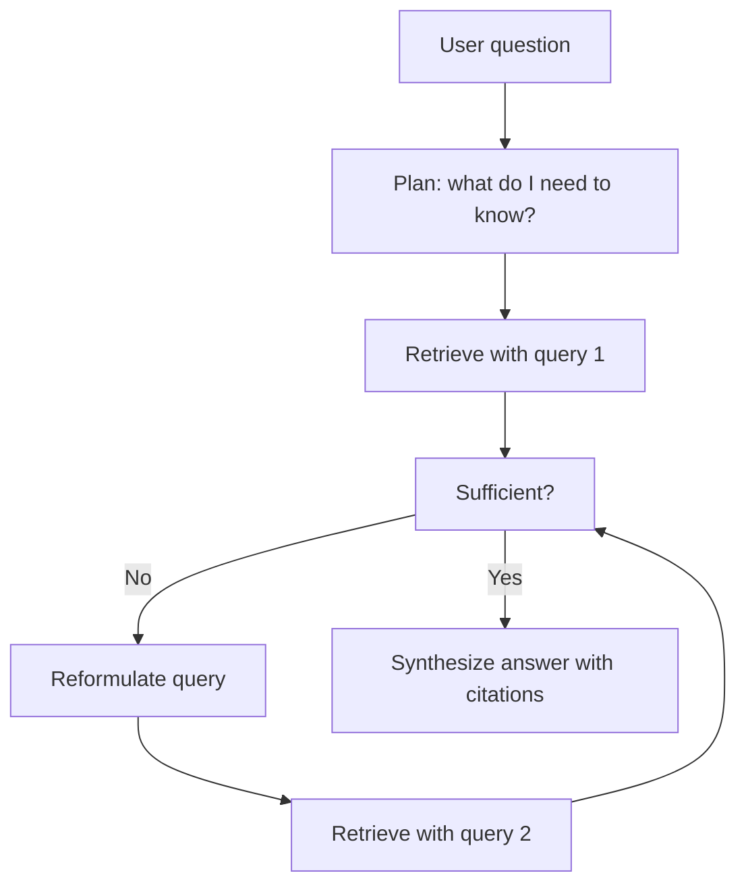

# Agentic RAG

> **Level:** ADV · **Last verified:** 2026-10-20 · **Sources:** [CRAG](https://arxiv.org/abs/2401.15884), [Anthropic tool use](https://platform.claude.com/docs/en/agents-and-tools/tool-use/overview)

## Why this matters

Naive RAG retrieves once, then answers. Agentic RAG treats retrieval as a tool: the agent decides when to retrieve, what query to use, whether to retrieve again, and when to stop. On hard multi-hop questions, agentic RAG outperforms naive RAG by 30–100% on recall. The expert caution: it does so at 3–10x the latency and cost of naive RAG, and it introduces failure modes naive RAG doesn't have (looping, query drift, retrieval obsession). Route, don't default.

## Core concepts

### The agentic RAG loop



### The loop's three decision points (and what actually goes wrong)

1. **Query formulation.** The agent's first query is usually the user's question verbatim — which is exactly what naive RAG would have run. The gain comes on *reformulation*: after seeing what came back, the agent knows what's missing. The failure mode is query drift: each reformulation chases a slightly different question, and by cycle 3 the agent is retrieving for a question nobody asked. Mitigate by requiring the agent to restate the *original* question each cycle.
2. **Sufficiency assessment.** "Is this enough to answer?" is a judgment call the model makes on its own retrieval — it can't know the corpus lacks the answer, so it answers from what it has (hallucinating confidence) or loops (never satisfied). Mitigations: a hard iteration cap, and teaching "insufficient evidence" as a *valid output* — "the docs don't cover X" is a correct answer, not a failure.
3. **Termination.** Fixed-cap (max 3 retrievals) is the robust default. Self-decided termination is a coin flip in one direction: models rarely stop at the theoretically-optimal point because they can't see the marginal value of one more retrieval.

### CRAG's core idea (and its descendants)

Corrective RAG (arXiv 2401.15884) added an **evaluation step**: a lightweight evaluator grades retrieved docs as correct/ambiguous/incorrect *before* generation; on failure it triggers web search as a fallback source. The durable idea isn't the specific evaluator — it's that *retrieval quality is checkable pre-generation*, and checking is cheap relative to generating from garbage. Every production agentic RAG system reinvents this check; naming it helps: retrieval-grading is a distinct component with its own eval, not a vibe the agent has.

### When agentic RAG wins

- Multi-hop questions ("Compare the revenue growth of Acme and Globex in Q3 2025" — two lookups + a comparison).
- Questions that need clarification ("Tell me about the API" — which API? v1 or v2?).
- Questions where the first retrieval misses (paraphrase mismatch, wrong vocabulary).
- Corpus exploration where the question itself evolves with evidence.

### When naive RAG wins

- Single-fact lookup (the 80% of traffic on most support corpora).
- High-throughput, low-latency UX (agentic adds 3–10x latency).
- Cost-sensitive workloads (every cycle is a full LLM call with growing context).

The routing question is empirical: log queries, sample 200, label single-hop vs multi-hop. If 90% are single-hop, route 90% to naive and give the agentic path a generous budget for the rest. Query classifiers can do this routing automatically — a cheap model classifying "simple lookup / needs decomposition / needs clarification" at <$0.0001/query.

## Code: agentic RAG with OpenAI Agents SDK

```python
from agents import Agent, Runner, function_tool

@function_tool
def search_docs(query: str) -> str:
    '''Search the internal documentation.'''
    # hybrid search + rerank, return top-5 chunks concatenated
    return retrieve(query)

agent = Agent(
    name="ResearchAgent",
    instructions='''You answer questions using the search_docs tool.
    - Restate the original question before each search.
    - If results don't fully answer it, reformulate and search again.
    - Maximum 3 searches. If evidence is still insufficient, say exactly
      which part the documentation doesn't cover — that is a valid answer.
    - Always cite the source doc name in your answer.''',
    tools=[search_docs],
    model="gpt-6.1-sol",
)

result = Runner.run_sync(agent, "How does Acme's rate limiter compare to Globex's?")
print(result.final_output)
```

The instructions encode the three mitigations: restate (anti-drift), cap (anti-loop), legitimate insufficiency (anti-hallucinated confidence).

## Production concerns

- **Latency:** Each retrieve + LLM-cycle is 2–5s. Three cycles = 10s+. Every cycle's context includes all prior retrievals — the per-cycle cost grows as the conversation lengthens (budget math in `02-context-engineering/01-context-budgeting.md`).
- **Cost:** Each cycle is a full LLM call over a growing context. A 3-cycle agentic query at ~8K context average on GPT-6.1 Sol ($2/1M in, $10/1M out) costs roughly $0.05-0.10 — 5-10x a naive single-call answer at $0.01-0.02. Cache the retrieved corpus prefix (`01-llm-calling/06-prompt-caching.md`) to claw back some of it.
- **Failure modes:** (1) looping on ambiguous queries — hard-cap iterations; (2) query drift — restate-original instructions; (3) answering despite insufficient evidence — legitimize "docs don't cover it"; (4) retrieval obsession — searching when it already has the answer in context; instruct "answer from context when sufficient."
- **Security:** Each retrieval returns untrusted text, and the agent *acts on* it across cycles — an injected doc can steer the *next* query (exfiltration via crafted retrieval). Re-scan every retrieved chunk for injection at retrieval time (`02-context-engineering/04-prompt-injection-defense.md`).
- **Eval:** Agentic RAG fails in ways naive RAG doesn't, so evaluate both paths separately: single-hop accuracy on the naive path, multi-hop accuracy + iteration-count distribution + insufficiency-call accuracy on the agentic path (`../07-evals/01-golden-datasets.md`).

## Anti-patterns

- ❌ **Defaulting to agentic RAG.** 80% of queries are single-hop; naive RAG is fine. Route.
- ❌ **No iteration cap.** Agents will loop.
- ❌ **No citation enforcement.** Agentic RAG without citations = hallucination factory.
- ❌ **Treating "insufficient evidence" as a failure.** It's the correct answer when true — punishing it teaches the model to fabricate.
- ❌ **Evaluating only end answers.** Log and review the *trace*: query reformulations and sufficiency decisions are where agentic RAG debugging happens.

## References

- [Corrective RAG (CRAG)](https://arxiv.org/abs/2401.15884) — verified 2026-10-20
- [Anthropic: Tool use](https://platform.claude.com/docs/en/agents-and-tools/tool-use/overview) — verified 2026-10-20
- [OpenAI Agents SDK](https://github.com/openai/openai-agents-python) — verified 2026-10-20
