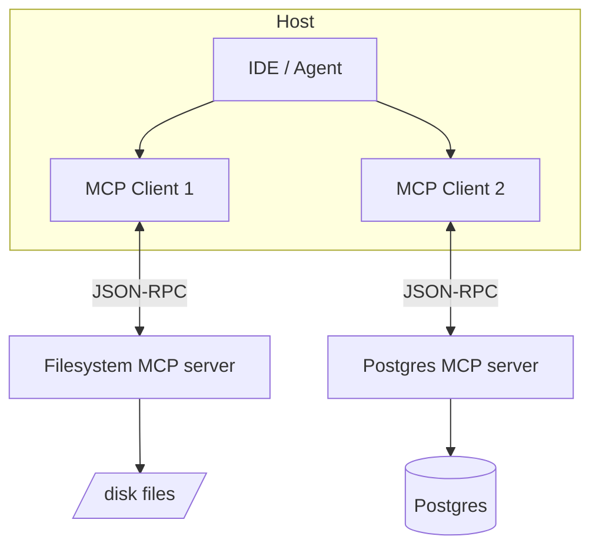

# MCP Architecture

> **Level:** INT · **Last verified:** 2026-10-20 · **Sources:** [MCP spec (2026-07-28)](https://modelcontextprotocol.io/specification/2026-07-28/basic/), [Anthropic announcement](https://www.anthropic.com/news/model-context-protocol)

## Why this matters

The Model Context Protocol (MCP), introduced by Anthropic in November 2024, has become the standard way to expose tools, resources, and prompts to LLMs in a vendor-neutral way. In 2026, every major IDE, agent framework, and most enterprise deployments support MCP servers, and the spec now ships on a dated-revision cadence (current: **2026-07-28**; prior revisions: 2025-11-25, 2025-06-18, 2025-03-26, 2024-11-05). Understanding MCP is table stakes. The expert view of *why* it won: before MCP, every app↔tool integration was a bespoke adapter (N apps × M tools); MCP collapses that to N apps + M servers speaking one protocol — the same network-effect argument as LSP for language tooling, which is MCP's explicit design ancestor.

## Core concepts

### What MCP standardizes

Three server primitives, plus two client-to-server capabilities added in 2025:

- **Tools** — functions the model can call (like function calling, but standardized). Tools can carry **annotations** (e.g. `readOnlyHint`, `destructiveHint`) so hosts can reason about safety without introspection. Annotations are *hints, not guarantees* — a malicious server can lie; they're for UX and policy defaults, not enforcement.
- **Resources** — static or dynamic data the model can read (files, DB rows). Resources are application-controlled (the host decides what to load); tools are model-controlled (the model decides what to call). This control distinction is the protocol's core security-relevant design line.
- **Prompts** — pre-built prompt templates the server exposes.
- **Sampling** (server → client) — a server can ask the client's LLM to complete a prompt, keeping the host in control of the model. This inverts the usual direction: your Postgres MCP server can *use* the LLM without embedding one, subject to the host's approval — recursive agent patterns (a tool that itself reasons) build on this.
- **Elicitation** (server → client) — a server can request structured input from the human through the client's UI. The protocol-sanctioned human-in-the-loop: a server mid-tool can ask "which account did you mean?" instead of failing.

### The architecture

A **host** (IDE, agent app) runs multiple **clients**, each connected 1:1 with one **server**. Three consequences of that 1:1 client-server shape:

- **Isolation by construction** — a hung or crashing server takes down its client, not the host; hosts enforce per-connection timeouts.
- **Per-server capability negotiation** — clients and servers exchange capabilities on connect; a client that doesn't support sampling simply never offers it, and servers degrade gracefully.
- **The host is the security boundary, not the protocol** — MCP authenticates *connections* (OAuth 2.1 remote), not *intent*. The host's approval policies (which server calls require user consent) are where safety actually lives.

### Transports

- **stdio** — local; the host spawns the server as a subprocess. The default for desktop clients. Zero network surface, but the server runs with *your* user's privileges — the trade-off that makes local MCP servers a real attack surface (a malicious stdio server can read SSH keys, env vars, anything you can).
- **Streamable HTTP** — remote; a single HTTP endpoint that upgrades to server-sent events for streaming. The only sanctioned remote transport since the 2025-03-26 revision. Supports optional client-resumability via session IDs.
- **HTTP+SSE** — the original remote transport; **deprecated and removed** — any guide still showing it is out of date.

Remote servers use **OAuth 2.1** authorization (resource server metadata, PKCE) — that's what makes third-party MCP servers deployable across the internet. Discovery is shifting to the **MCP Registry** (shipped with the 2025-11-25 revision) — publish there rather than expecting users to paste URLs.

### The protocol-version negotiation reality

Servers and clients declare protocol versions on connect; mismatches negotiate down to the shared version. In practice this means: a server written against 2025-03-26 still works with a 2026-07-28 client — but features added later (Registry discovery, newer auth flows) are simply unavailable on that connection. When you depend on a post-2025 feature, gate on the negotiated version, not on "MCP supports X."

### MCP vs plain function calling — when you don't need it

MCP solves *distribution and reuse*: one server, many hosts, zero per-host adapter code. If your tool is used by exactly one application that you also own, plain function calling (`01-function-calling-across-providers.md`) is simpler — fewer moving parts, no JSON-RPC, no capability negotiation. MCP earns its complexity the moment a second consumer appears (an IDE, a different team's agent, an off-the-shelf client) or when tool logic must run near the data (the Postgres server connects once; every host reuses that connection).

## Production concerns

- **Latency:** stdio is fast (no network). HTTP adds RTT per tool call — for chatty agents (10+ tool calls per task), remote-MCP latency compounds; co-locate servers with data and keep round-trips down.
- **Cost:** MCP servers are yours to run. Cheap at scale; not zero — a remote server with per-request auth (token validation, JWKS fetch) adds 10-50ms and an infra component to monitor.
- **Failure modes:** (1) a misbehaving server can hang the agent — always set timeouts on every tool call (host-side, not server-side promises); (2) zombie stdio processes after host crash — kill process trees, not just the parent; (3) version-drift breakage — pin the SDK version your server was built against and test on spec revisions before upgrading.
- **Security:** Treat MCP servers like database drivers — the protocol carries whatever the server chooses to send. Sandbox stdio servers (run them as a restricted user/container; they inherit your filesystem). For remote: OAuth scopes per server, audit `tools/call` logs, and remember tool **annotations are unverified claims** — a `readOnlyHint` on a server you didn't write is a label, not a fact. The confused-deputy risk: a malicious server can use *sampling* to make your own LLM do its bidding — approve sampling requests explicitly.
- **Supply chain:** an MCP server is a dependency you *execute*. Vet them like you'd vet a package: read the code or the publisher, prefer Registry-published servers with provenance, and watch for servers that change behavior after updates (tool schemas are fetched at runtime — a server can silently add an exfiltration tool).

## Anti-patterns

- ❌ **Exposing raw SQL via MCP without read-only enforcement.**
- ❌ **Running untrusted MCP servers in the same process as your agent.** Or with your user's privileges.
- ❌ **One giant MCP server with 50 tools.** Split by domain — hosts load tool lists into every request's context; 50 tools is both a selection-accuracy and token-cost problem.
- ❌ **Building on HTTP+SSE examples from old tutorials.** That transport is removed from the spec.
- ❌ **Trusting tool annotations as enforcement.** They're hints from the server about itself.

## Decision framework

| Need | Use |
|------|-----|
| Local desktop tool (files, shell) | stdio server, sandboxed user |
| Remote/hosted server | Streamable HTTP + OAuth 2.1 |
| Distribution to third parties | Publish to the MCP Registry |
| Server needs LLM help mid-tool | Sampling (client-mediated, explicitly approved) |
| Server needs user input mid-tool | Elicitation |
| One app, one tool, you own both | Plain function calling — MCP is overkill |

## References

- [MCP spec, revision 2026-07-28](https://modelcontextprotocol.io/specification/2026-07-28/basic/) — verified 2026-10-20
- [Anthropic MCP announcement](https://www.anthropic.com/news/model-context-protocol) — verified 2026-10-20
- [MCP servers repo](https://github.com/modelcontextprotocol/servers) — verified 2026-10-20
