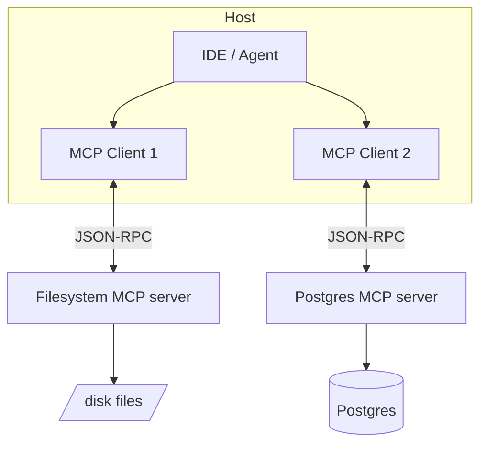

# MCP Architecture

> **Level:** INT · **Last verified:** 2026-10-20 · **Sources:** [MCP spec (2026-07-28)](https://modelcontextprotocol.io/docs/2026-07-28/basic/), [Anthropic announcement](https://www.anthropic.com/news/model-context-protocol)

## Why this matters

The Model Context Protocol (MCP), introduced by Anthropic in November 2024, has become the standard way to expose tools, resources, and prompts to LLMs in a vendor-neutral way. In 2026, every major IDE, agent framework, and most enterprise deployments support MCP servers, and the spec now ships on a dated-revision cadence (current: **2026-07-28**; prior revisions: 2025-11-25, 2025-06-18, 2025-03-26, 2024-11-05). Understanding MCP is table stakes.

## Core concepts

### What MCP standardizes

Three server primitives, plus two client-to-server capabilities added in 2025:
- **Tools** — functions the model can call (like function calling, but standardized). Tools can carry **annotations** (e.g. `readOnlyHint`) so hosts can reason about safety without introspection.
- **Resources** — static or dynamic data the model can read (files, DB rows).
- **Prompts** — pre-built prompt templates the server exposes.
- **Sampling** (server → client) — a server can ask the client's LLM to complete a prompt, keeping the host in control of the model.
- **Elicitation** (server → client) — a server can request structured input from the human through the client's UI.

### The architecture

A **host** (IDE, agent app) runs multiple **clients**, each connected to one **server**. Servers expose tools/resources/prompts. Clients negotiate capabilities on connect.

### Transports

- **stdio** — local; the host spawns the server as a subprocess. The default for desktop clients.
- **Streamable HTTP** — remote; a single HTTP endpoint that upgrades to server-sent events for streaming. The only sanctioned remote transport since the 2025-03-26 revision.
- **HTTP+SSE** — the original remote transport; **deprecated and removed** — any guide still showing it is out of date.

Remote servers use **OAuth 2.1** authorization (resource server metadata, PKCE) — that's what makes third-party MCP servers deployable across the internet. Discovery is shifting to the **MCP Registry** (shipped with the 2025-11-25 revision) — publish there rather than expecting users to paste URLs.

## Production concerns

- **Latency:** stdio is fast (no network). HTTP adds RTT per tool call.
- **Cost:** MCP servers are yours to run. Cheap at scale; not zero.
- **Failure modes:** A misbehaving MCP server can hang the agent. Always have timeouts.
- **Security:** Treat MCP servers like database drivers. Sandbox them. A malicious filesystem MCP server can read SSH keys.

## Anti-patterns

- ❌ **Exposing raw SQL via MCP without read-only enforcement.**
- ❌ **Running untrusted MCP servers in the same process as your agent.**
- ❌ **One giant MCP server with 50 tools.** Split by domain.
- ❌ **Building on HTTP+SSE examples from old tutorials.** That transport is removed from the spec.

## Decision framework

| Need | Use |
|------|-----|
| Local desktop tool (files, shell) | stdio server |
| Remote/hosted server | Streamable HTTP + OAuth 2.1 |
| Distribution to third parties | Publish to the MCP Registry |
| Server needs LLM help mid-tool | Sampling (client-mediated) |
| Server needs user input mid-tool | Elicitation |

## References

- [MCP spec, revision 2026-07-28](https://modelcontextprotocol.io/docs/2026-07-28/basic/) — verified 2026-10-20
- [Anthropic MCP announcement](https://www.anthropic.com/news/model-context-protocol) — verified 2026-10-20
- [MCP servers repo](https://github.com/modelcontextprotocol/servers) — verified 2026-10-20
