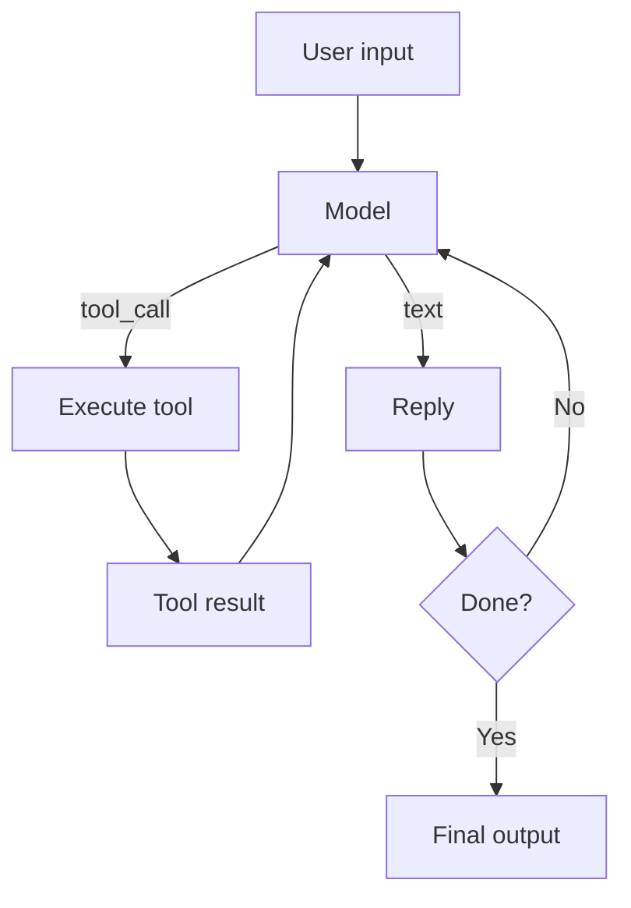

# OpenAI Agents SDK

> **Level:** INT · **Last verified:** 2026-10-20 · **Sources:** [OpenAI Agents SDK](https://github.com/openai/openai-agents-python)

## Why this matters

OpenAI's Agents SDK is the simplest path to a production single-agent system if you're already on OpenAI. It handles the agent loop, tool calls, structured outputs, and handoffs with minimal boilerplate. The expert reading of its design: it is a *thin, unopinionated* runtime — the SDK gives you the loop and the plumbing (tracing, sessions, guardrails hooks) and deliberately refuses to impose a workflow shape. That's a feature (fewer framework concepts to fight) and a responsibility (structure, state discipline, and multi-agent topology are your job).

## Core concepts

### The four primitives

- **Agent** — instructions + model + tools. An `Agent` is immutable config, not a running thing.
- **Runner** — the loop that calls the model, executes tools, feeds results back. Built on the **Responses API**. The `Runner` owns turn boundaries and `max_turns` enforcement.
- **Tool** — a Python function decorated with `@function_tool`, or a `Tool` wrapper. **MCP servers** plug in directly as tool sources.
- **Handoff** — a way for one agent to delegate to another.

Two more you'll meet in production: **guardrails** (`@input_guardrail` / `@output_guardrail` — checks that run before/after the agent; see `05-guardrails-retries-fallbacks.md`) and built-in **tracing** (a trace UI for every run, no setup required — disable it in prod with `set_tracing_disabled(True)`). Non-OpenAI models work via `set_default_openai_client` with any OpenAI-compatible endpoint or LiteLLM.

### The loop — and what the SDK does NOT do for you



Knowing the loop's boundaries is the expert's mental model:

- **Session state is yours.** The SDK's `session` support persists message history across runs, but durable domain state (that order 1234 was already refunded) lives in your database, threaded through tools. Agents that keep domain state in the conversation reliably lose it (compaction, truncation, new sessions).
- **Loop termination is cooperative.** `max_turns` is a hard stop (raises `MaxTurnsExceeded`), but graceful termination comes from the model deciding it's done. If your instructions never say when to stop, the model decides socially, not correctly.
- **Tool execution is single-threaded per turn by default** — parallel tool calls from the model execute via `function_tools` sequentially unless you provide async tools and let the runner fan out. Slow tools in sequence dominate wall-clock time.

### Handoffs — the multi-agent escape hatch

`handoffs=[billing_agent, support_agent]` compiles to a tool the model can call; the conversation *transfers* — the new agent's instructions replace the old one's, and history carries over. Two semantic consequences:

1. **History transplant.** The receiving agent sees the whole prior transcript. If agent A had tools that agent B lacks, B reads references to calls it can't repeat — usually fine, occasionally confusing (B tries to "call" A's tools). Keep handoff peers' toolsets coherent or summarize-at-handoff.
2. **Handoff ≠ return.** After the handoff, the original agent is out of the loop — there's no automatic "return to triage." For supervisor patterns (delegate, get answer back, continue), use the `Task` tool / agent-as-tool pattern rather than handoffs; for a routing pattern (triage → specialist → done), handoffs are correct.

### Sessions vs. state vs. context — three different things

- **Session** (`SQLiteSession` etc.) — persisted message history, survives process restarts. The "what was said" layer.
- **Local state** (`RunContextWrapper.context`) — per-run mutable Python state your tools share (DB handles, request IDs). The "what's happening now" layer.
- **Model context** — the actual token window; managed by trimming/compaction strategies (`../02-context-engineering/03-context-distillation.md`). The "what the model sees" layer.

Conflating them produces the classic bug: storing durable facts in session history (lost on compaction) or in the token window (lost on restart).

## Code: minimal agent

```python
from agents import Agent, Runner, function_tool

@function_tool
def get_weather(city: str) -> str:
    '''Get weather for a city.'''
    return f"Sunny, 22C in {city}."

agent = Agent(
    name="WeatherAgent",
    instructions="You are a helpful weather assistant. Always use the get_weather tool. "
                 "Answer in one sentence and stop — do not call more tools after you have the answer.",
    tools=[get_weather],
    model="gpt-6.1-sol",
)

result = Runner.run_sync(agent, "What's the weather in Tokyo?", max_turns=5)
print(result.final_output)
```

Note the instructions encode *termination guidance* — cheap insurance against wandering loops.

## Code: agent with handoff (routing pattern)

```python
from agents import Agent, Runner

billing_agent = Agent(name="Billing", instructions="You handle billing questions.", model="gpt-6.1-sol")
support_agent = Agent(name="Support", instructions="You handle technical support.", model="gpt-6.1-sol")

triage = Agent(
    name="Triage",
    instructions="Route the user to billing or support based on their question. "
                 "If unclear, ask one clarifying question first — do not hand off on a guess.",
    handoffs=[billing_agent, support_agent],
    model="gpt-6.1-sol",
)

result = Runner.run_sync(triage, "I was charged twice last month.", max_turns=5)
```

## Code: agent-as-tool (supervisor pattern)

```python
from agents import Agent, Runner

researcher = Agent(name="Researcher", instructions="Gather facts. Return a 3-bullet summary.",
                   model="gpt-6.1-sol")
writer = Agent(name="Writer", instructions="Write the brief from the provided facts.",
               model="gpt-6.1-sol")

orchestrator = Agent(
    name="Orchestrator",
    instructions="First call researcher, then call writer with its output.",
    tools=[researcher.as_tool(tool_name="research", tool_description="Gather facts on a topic"),
           writer.as_tool(tool_name="write", tool_description="Write the brief from facts")],
    model="gpt-6.1-sol",
)
# Contrast with handoffs: the orchestrator stays in control and composes sub-agents' outputs.
```

## Production concerns

- **Latency:** Each loop iteration is a full LLM call; tool calls within a turn can parallelize if your tools are async. p95 tuning: reduce turns (better instructions/tool design) before shaving per-call latency.
- **Cost:** Tool definitions count toward input tokens on every iteration — and unlike a chat system prompt, tool schemas ride along even when unused. Prompt caching mitigates; per-route tool pruning (`04-tools-and-mcp/01`) multiplies it.
- **Failure modes:** (1) loop exhaustion — `MaxTurnsExceeded` mid-task leaves a half-done side effect; design tools idempotently so re-running the task is safe; (2) handoff history transplant confusion (above); (3) tracing enabled in prod — the default trace export is a data egress path you didn't configure; disable or route it deliberately.
- **Security:** Tool args are model-generated — validate at the tool boundary (the SDK executes whatever the model emits; your tool body is the enforcement point). Handoff targets are static config, which is good: the model can't invent new agents.

## Anti-patterns

- ❌ **One agent with 30 tools.** Split into multiple agents with handoffs or agent-as-tool.
- ❌ **No `max_turns`.** Infinite loops in production.
- ❌ **Trusting tool args without validation.**
- ❌ **Storing durable domain state in the conversation.** Sessions are for history; the DB is for truth.
- ❌ **Using handoffs where you need the caller back.** `as_tool` composes; handoff transfers.

## Decision framework

| Need | Use |
|------|-----|
| Fastest path to a working single agent | This SDK |
| Multi-agent with durable state / checkpoints | LangGraph (`03-langgraph-stateful-agents.md`) |
| Type-safe outputs, no agent loop | Pydantic AI / Instructor (`04-pydantic-ai-instructor.md`) |
| File-operating, hours-long agents | Claude Agent SDK (`02-anthropic-claude-agent-sdk.md`) |
| Full comparison | `../docs/decision-guides/choosing-an-agent-sdk.md` |

## References

- [OpenAI Agents SDK](https://github.com/openai/openai-agents-python) — verified 2026-10-20
- [OpenAI Agents docs](https://openai.github.io/openai-agents-python/) — verified 2026-10-20
