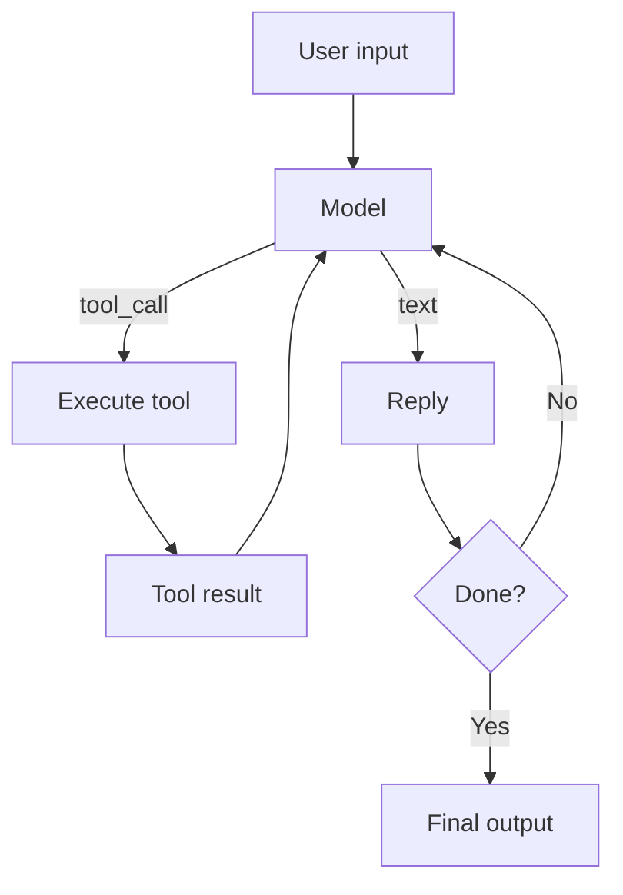

# OpenAI Agents SDK

> **Level:** INT · **Last verified:** 2026-10-20 · **Sources:** [OpenAI Agents SDK](https://github.com/openai/openai-agents-python)

## Why this matters

OpenAI's Agents SDK is the simplest path to a production single-agent system if you're already on OpenAI. It handles the agent loop, tool calls, structured outputs, and handoffs with minimal boilerplate.

## Core concepts

### The four primitives

- **Agent** — instructions + model + tools.
- **Runner** — the loop that calls the model, executes tools, feeds results back. Built on the **Responses API**.
- **Tool** — a Python function decorated with `@function_tool`, or a `Tool` wrapper. **MCP servers** plug in directly as tool sources.
- **Handoff** — a way for one agent to delegate to another.

Two more you'll meet in production: **guardrails** (`@input_guardrail` / `@output_guardrail` — checks that run before/after the agent; see `05-guardrails-retries-fallbacks.md`) and built-in **tracing** (a trace UI for every run, no setup required — disable it in prod with `set_tracing_disabled(True)`). Non-OpenAI models work via `set_default_openai_client` with any OpenAI-compatible endpoint or LiteLLM.

### The agent loop



## Code: minimal agent

```python
from agents import Agent, Runner, function_tool

@function_tool
def get_weather(city: str) -> str:
    '''Get weather for a city.'''
    return f"Sunny, 22C in {city}."

agent = Agent(
    name="WeatherAgent",
    instructions="You are a helpful weather assistant. Always use the get_weather tool.",
    tools=[get_weather],
    model="gpt-6.1-sol",
)

result = Runner.run_sync(agent, "What's the weather in Tokyo?", max_turns=5)
print(result.final_output)
```

## Code: agent with handoff

```python
from agents import Agent, Runner

billing_agent = Agent(name="Billing", instructions="You handle billing questions.", model="gpt-6.1-sol")
support_agent = Agent(name="Support", instructions="You handle technical support.", model="gpt-6.1-sol")

triage = Agent(
    name="Triage",
    instructions="Route the user to billing or support based on their question.",
    handoffs=[billing_agent, support_agent],
    model="gpt-6.1-sol",
)

result = Runner.run_sync(triage, "I was charged twice last month.", max_turns=5)
```

## Production concerns

- **Latency:** Each loop iteration is a full LLM call. Cap iterations.
- **Cost:** Tool definitions count toward input tokens on every iteration.
- **Failure modes:** Agents loop. Always set `max_turns`.
- **Security:** Tool args are model-generated. Validate.

## Anti-patterns

- ❌ **One agent with 30 tools.** Split into multiple agents with handoffs.
- ❌ **No `max_turns`.** Infinite loops in production.
- ❌ **Trusting tool args without validation.**

## Decision framework

| Need | Use |
|------|-----|
| Fastest path to a working single agent | This SDK |
| Multi-agent with durable state / checkpoints | LangGraph (`03-langgraph-stateful-agents.md`) |
| Type-safe outputs, no agent loop | Pydantic AI / Instructor (`04-pydantic-ai-instructor.md`) |
| File-operating, hours-long agents | Claude Agent SDK (`02-anthropic-claude-agent-sdk.md`) |
| Full comparison | `../docs/decision-guides/choosing-an-agent-sdk.md` |

## References

- [OpenAI Agents SDK](https://github.com/openai/openai-agents-python) — verified 2026-10-20
- [OpenAI Agents docs](https://openai.github.io/openai-agents-python/) — verified 2026-10-20
