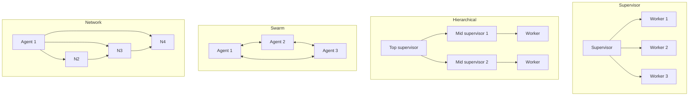
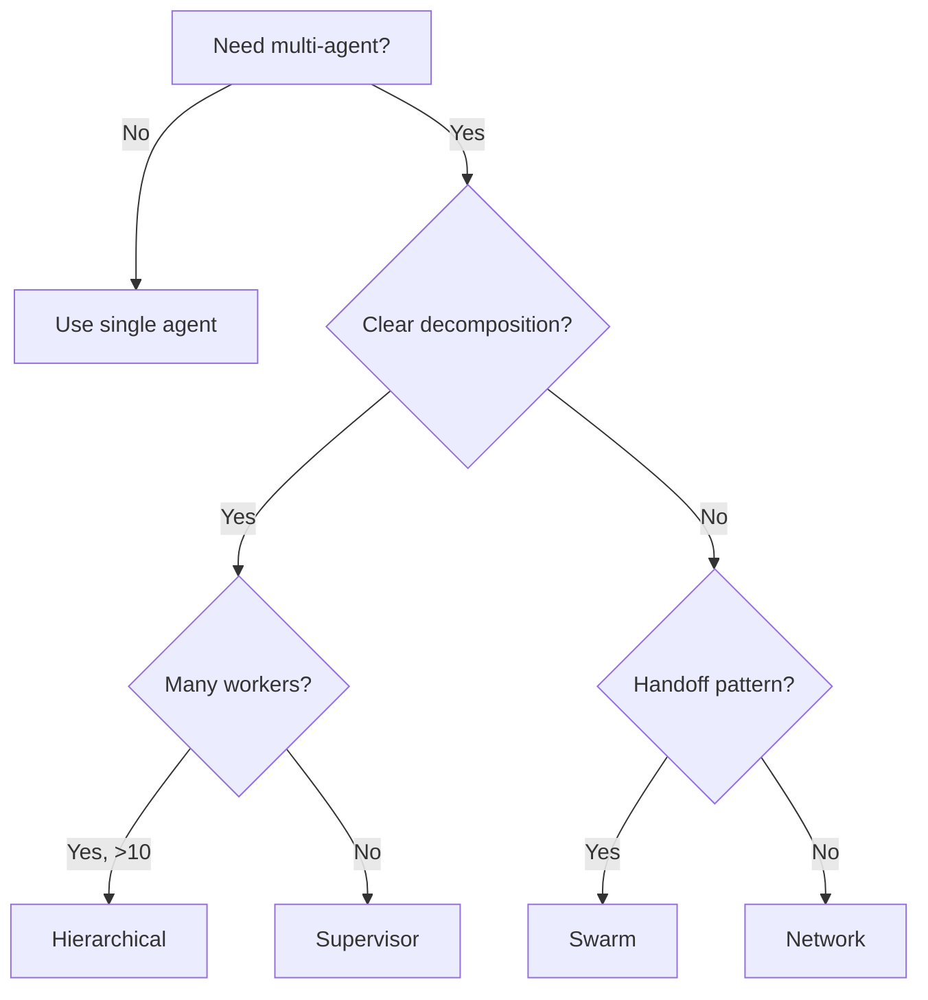

# Multi-Agent Orchestration Topologies

> **Level:** ADV · **Last verified:** 2026-10-20 · **Sources:** [LangGraph multi-agent](https://docs.langchain.com/oss/python/langchain/multi-agent), [Anthropic: Building effective agents](https://www.anthropic.com/research/building-effective-agents)

## Why this matters

The architecture of your multi-agent system is the highest-leverage design decision. Pick the wrong topology and you get agents stepping on each other, infinite handoffs, and untraceable failures. Pick the right one and the system feels designed. The expert framing: a topology is a *communication structure*, and what you're really choosing is where control lives (who decides the next step) and how context flows (what each agent sees). Every failure mode — duplication, deadlock, drift — follows from those two properties.

## Core concepts

### The first question: do you need multi-agent at all?

Multi-agent is not an upgrade to single-agent — it's a different tool with real overhead (N× context re-priming, handoff latency, emergent coordination failures). The honest triggers for multi-agent:

- **Context isolation** — subtasks need different, *incompatible* contexts (a researcher reading 50 documents shouldn't carry the writer's prose constraints; separate contexts keep each focused and cheap).
- **Parallelism** — subtasks are independent and wall-clock matters (5 researchers on 5 shards).
- **Tool/permission separation** — different trust levels per subtask (the untrusted-content reader gets no write tools — `02-context-engineering/04-prompt-injection-defense.md`'s privilege separation is a *topology* decision).
- **Specialization** — different models per stage (cheap model for extraction, frontier for synthesis).

If none of these apply, a single agent with good tools wins: fewer moving parts, one context to debug, no handoff losses. Anthropic's "Building effective agents" makes the same point: start with the simplest composition that works (single agent, then prompt-chaining, then routing), add agents only when a *specific* constraint forces it.

### Four topologies



| Topology | Control lives | Context flow | Dominant failure |
|----------|---------------|--------------|------------------|
| **Supervisor** | One brain routes all steps | Workers see distilled task; supervisor sees summaries | Supervisor bottleneck + context bloat at the center |
| **Hierarchical** | Delegated per subtree | Distilled per level | Debugging across levels; duplicated work between branches |
| **Swarm** | Whoever holds the conversation | Full transcript carries across handoffs | Drift — the conversation wanders off-task |
| **Network** | Emergent (any agent calls any) | Per-call payloads | Deadlock, loops, untraceable causality |

The control/context table is the expert view: the beginner table says "when to use each"; this one tells you *which property you're trading*. Supervisor buys predictability with a bottleneck; swarm buys flexibility with drift; network buys power with chaos — which is why network topologies in production are always *constrained* networks (allowlists of who may call whom, cycle detection).

### Supervisor patterns: router vs planner

"Supervisor" hides two different jobs:

- **Router supervisor** — maps task → worker, once (triage). Cheap, stateless, effectively a classifier. This is handoff territory (`02-handoff-protocols.md`).
- **Planner supervisor** — decomposes the task into a plan, dispatches steps, integrates results, possibly replans. This is an *agentic* supervisor — its context grows with every worker report, and its planning quality degrades as that context bloats (the same effective-context limits as `02-context-engineering/01-context-budgeting.md`). Mitigate: workers return structured results (not prose), supervisor compacts finished branches.

### Convergence and termination

Every multi-agent system needs an explicit answer to "when is this done?" — and the answer must be *checkable*, not felt:

- **Goal predicates** — "all plan steps completed AND critic approved" — evaluated by code, not the model's mood.
- **Iteration/depth caps** — hard stops that convert infinite loops into errors you can alert on.
- **Cycle detection** — in swarm/network: track (agent, task) pairs; a repeat is a loop, break it.
- **Budget termination** — token/cost caps that end the run gracefully (checkpoint + report partial — `04-long-horizon-tasks.md`).

The classic production failure isn't deadlock — it's *live-lock*: agents keep productively doing things while never converging on done. Convergence criteria designed upfront are the vaccine.

### Observability: causality across agents

When a multi-agent run produces a wrong answer, "which agent went wrong" is the debugging question. Answer it by design: every inter-agent message carries a correlation id (the run's trace root), and every agent's contribution is logged with (input, output, tokens, latency). Without this, you're reconstructing causality from vibes. OpenTelemetry's GenAI semantic conventions (`../08-production/03-observability-opentelemetry.md`) give you the span model; distributed tracing was built for exactly this shape of problem.

## Decision tree



## Code: minimal supervisor (LangGraph)

```python
from typing import TypedDict, Literal
from langgraph.graph import StateGraph, START, END

class State(TypedDict):
    query: str
    plan: list[str]
    results: list[str]

def supervisor(state: State) -> State:
    plan = ["research", "write"] if "report" in state["query"] else ["answer"]
    return {**state, "plan": plan}

def route(state: State) -> Literal["researcher", "writer", END]:
    if "research" in state["plan"]:
        return "researcher"
    return END

g = StateGraph(State)
g.add_node("supervisor", supervisor)
g.add_node("researcher", lambda s: {**s, "results": ["..."]})
g.add_node("writer", lambda s: {**s, "results": s["results"] + ["..."]})
g.add_edge(START, "supervisor")
g.add_conditional_edges("supervisor", route, ["researcher", "writer", END])
g.add_edge("researcher", "writer")
g.add_edge("writer", END)
app = g.compile()
```

## Production concerns

- **Latency:** Every handoff adds an LLM call *plus* the receiving agent's context re-priming (its instructions + whatever you pass). Parallelize independent workers; serialize only true dependencies.
- **Cost:** Multi-agent = N× single-agent cost *at minimum* — each agent pays for its own system prompt, tools, and the context you hand it. The multiplier compounds with depth (hierarchy of 3 levels ≈ 1+2+4 agents' fixed costs). Budget per-run caps from day one.
- **Failure modes:** (1) deadlock — timeouts on every wait; (2) live-lock — convergence criteria (above); (3) duplicated work — two branches solving the same sub-task; artifact IDs deduplicate; (4) the supervisor's context bloat — structured worker outputs, compaction.
- **Security:** Each agent has its own tool access — limit blast radius per agent, and put the *untrusted-input* agents in the most tool-poor position (privilege separation by topology, not by policy).

## Anti-patterns

- ❌ **Network topology with no handoff protocol.** Spaghetti.
- ❌ **Supervisor with 20 direct reports.** Split into hierarchy.
- ❌ **No iteration cap.** Infinite loops.
- ❌ **Multi-agent "because it's more powerful."** It's more *expensive*; it's more powerful only when a specific constraint (context isolation, parallelism, permissions, specialization) demands it.
- ❌ **Prose handoffs between agents.** Structured outputs make worker results parseable, compact, and debuggable.
- ❌ **No correlation ids.** Multi-agent debugging without causality traces is guesswork.

## References

- [LangGraph: Multi-agent concepts](https://docs.langchain.com/oss/python/langchain/multi-agent) — verified 2026-10-20
- [CrewAI: Crew architecture](https://docs.crewai.com/concepts/crews) — verified 2026-10-20
- [Anthropic: Building effective agents](https://www.anthropic.com/research/building-effective-agents) — verified 2026-10-20
