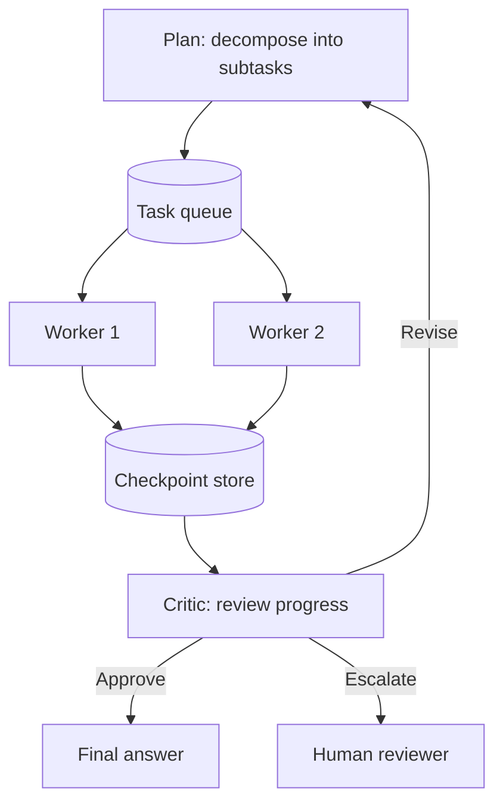

# Long-Horizon Tasks

> **Level:** EXP · **Last verified:** 2026-10-20 · **Sources:** [LangGraph persistence](https://docs.langchain.com/oss/python/langgraph/persistence), [Anthropic: Building effective agents](https://www.anthropic.com/research/building-effective-agents)

## Why this matters

An agent that runs for 5 minutes is hard. An agent that runs for 5 hours is a different beast: state grows, intermediate failures accumulate, costs compound, and you need pause/resume. Long-horizon agents are the frontier of production GenAI in 2026. The expert framing: a long-horizon run is a *stateful distributed system* whose workers are non-deterministic and whose every step costs money. The engineering is mostly classical (queues, checkpoints, budgets, escalation) — the new parts are that failures are *soft* (wrong-but-plausible outputs, not exceptions) and that resuming has *token cost* (re-priming context the crashed process already paid for).

## Core concepts

### The four problems

1. **State size** — context grows; you must distill.
2. **Failure recovery** — every step can fail; you must checkpoint.
3. **Cost control** — 5 hours of frontier-model calls is $100s; you must budget.
4. **Human oversight** — humans can't watch 5 hours; you must summarize.

Each problem has a *classical* counterpart you should steal from: state size → database normalization + archival; failure recovery → write-ahead logs / saga patterns; cost control → circuit breakers + quota; oversight → shift-handover reports. What's genuinely new: **soft failures**. A crashed worker raises an exception (classical, detectable); a worker that *confidently took the wrong branch* at hour 2 raises nothing — you need critics and eval hooks to catch it, and the wrongness compounds silently until the final artifact is subtly corrupted. Long-horizon reliability is therefore less about retrying failures and more about *detecting drift* before it compounds.

### The architecture



### Key patterns

- **Plan-then-execute** — decompose upfront, execute subtasks in parallel. The plan is a *checkable artifact* (list of steps with completion predicates), not a vibe. Replanning is explicit (the critic triggers it), never silent — silent replans make the run's actual behavior diverge from every log you're keeping.
- **Checkpoint every step** — durable storage; resume on crash. The unit of checkpointing is the *completed semantic step* (sub-task done, artifact stored), not the LLM call — resuming mid-thought re-pays context and re-rolls dice you don't need to.
- **Periodic critic review** — every N steps, a critic evaluates progress. This is your drift detector: the critic checks "does the work so far still serve the original goal?" with fresh eyes (its own context: goal + plan + summaries — not the worker's full history, which is how it avoids inheriting the worker's frame).
- **Human escalation** — defined trigger conditions for human review. Escalation triggers must be *mechanical* (cost > X, critic confidence < Y, N consecutive failed verifications, any destructive-action request) — judgment-call escalations fire inconsistently and train ops to ignore them.
- **Cost budget** — hard cap on tokens; agent must request more.

### Resumption economics (the cost of a crash)

A naive restart re-runs from scratch: full token cost again, plus *different* results (non-determinism), which invalidates anything downstream that referenced the first attempt's outputs. Checkpointed resumption changes the math: you re-pay only the current step's context re-priming. The design rule that follows: **make every sub-task's outputs idempotent artifacts** (stored under stable IDs — file paths, DB rows, artifact-store keys). Then resume = "load plan state, re-run in-flight step only," and downstream references survive restarts. This is the saga pattern with token costs.

### Progress visibility (the product requirement everyone misses)

A 5-hour run needs a progress surface: what's done, what's running, what's blocked, current spend vs budget, critic verdicts. This isn't observability garnish — it's how humans trust (and intervene in) an autonomous process. The same event stream feeds it and your escalation triggers: build one structured event log (step started/finished, artifacts, costs, critic verdicts) and both dashboards and alerting fall out for free.

## Code: skeleton with checkpoints

```python
from typing import TypedDict
from langgraph.graph import StateGraph, START, END
from langgraph.checkpoint.postgres import PostgresSaver

class State(TypedDict):
    plan: list[str]
    completed: list[str]
    artifacts: dict
    cost_spent: float

def planner(state: State) -> dict: ...      # return state DELTAS
def worker(state: State) -> dict: ...
def human_review(state: State) -> dict: ...  # real node fn (interrupt gate)

def route_after_critic(state: State) -> str:  # router ONLY - never a node
    if state["cost_spent"] > 50.0:
        return "human_review"
    if all(s in state["completed"] for s in state["plan"]):
        return END
    return "worker"

graph = StateGraph(State)
graph.add_node("planner", planner)
graph.add_node("worker", worker)
graph.add_node("critic", lambda s: s)         # inspect/compact; pass-through
graph.add_node("human_review", human_review)
graph.add_edge(START, "planner")
graph.add_edge("planner", "worker")
graph.add_edge("worker", "critic")
graph.add_conditional_edges("critic", route_after_critic,
                            ["worker", "human_review", END])

with PostgresSaver.from_conn_string("postgresql://...") as checkpointer:
    checkpointer.setup()                       # required: create tables
    app = graph.compile(checkpointer=checkpointer)
    # each step is durable; resume any thread after a crash
```

## Production concerns

- **Latency:** 5-hour agent = user can't wait. Async + notifications — the user-facing contract is "started / progressing / done," never a synchronous request. Design the notification moments (milestones, escalations, completion) at the same time as the graph.
- **Cost:** Hard-cap. Alert at 50%, 80%, 100%. Track spend *per sub-task* and per artifact so overrun post-mortems identify *which* part of the plan burned the budget (aggregate totals tell you it happened, not why).
- **Failure modes:** (1) crashes mid-run — resume from last checkpoint; (2) drift — critic reviews with fresh context; (3) runaway loops on unsolvable sub-tasks — per-sub-task attempt caps + escalation; (4) poisoned artifacts — a wrong early output referenced by everything after; the critic checks artifacts against goal, not just "did the step complete."
- **Security:** Artifacts may contain sensitive data. Encrypt checkpoints; scope artifact access per run; and mind *accumulated* exposure — a 5-hour run's event log contains the corpus of everything the agent touched, which is a bigger sensitive-data surface than any single turn.
- **Testing:** Replay tests from checkpoints are your integration suite: fork a real run's checkpoint, inject a failure, verify resume produces equivalent (not identical) completion. Test the escalation triggers by forcing each condition — an untested escalation path fails exactly when it matters.

## Anti-patterns

- ❌ **No checkpointing.** Crash = full restart — full cost, plus non-deterministic divergence.
- ❌ **No cost cap.** One bug = $1000s.
- ❌ **No human escalation.** Agent runs forever on unsolvable sub-task.
- ❌ **Checkpointing mid-thought instead of at semantic boundaries.** Resume re-pays context and re-rolls settled decisions.
- ❌ **Silent replanning.** Every plan change is an event; otherwise logs describe a run that didn't happen.
- ❌ **Critic reading the worker's full history.** Fresh eyes catch drift; inherited context doesn't.
- ❌ **Synchronous UX on an async process.** The contract is notifications, not a spinner.

## References

- [LangGraph: Long-running agents](https://docs.langchain.com/oss/python/langgraph/persistence) — verified 2026-10-20
- [Anthropic: Building effective agents](https://www.anthropic.com/research/building-effective-agents) — verified 2026-10-20
- [DeepAgents](https://github.com/langchain-ai/deepagents) — verified 2026-10-20
