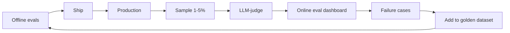

# Online vs Offline Evals

> **Level:** INT · **Last verified:** 2026-10-20 · **Sources:** [Arize Phoenix](https://github.com/Arize-ai/phoenix), [LangSmith evaluation](https://docs.smith.langchain.com/evaluation)

## Why this matters

Offline evals catch regressions before you ship. Online evals catch problems in production you couldn't have predicted. You need both. Skipping either is malpractice. The expert framing: offline evals measure *the system you built* against *the spec you imagined*; online evals measure *the system as experienced by users*, including everything your imagination missed. The gap between the two scores is itself a signal — it's the measure of how well your golden set represents reality.

## Core concepts

### Offline evals

- **When:** Pre-merge, in CI.
- **What:** Golden dataset + LLM-judge + assertions.
- **Cost:** Predictable; runs on every PR.
- **Catches:** Regressions on known cases.

### Online evals

- **When:** Continuous, in production.
- **What:** Sample 1–5% of traffic; judge with LLM-rubric.
- **Cost:** Variable; budgeted.
- **Catches:** Drift, new failure modes, distribution shift.

### The feedback loop



The loop's *speed* is what makes it work — the cycle time from "failure appears in production sampling" to "golden case added, regression gated in CI" is the metric that matters. A loop that takes a month means a month of repeated failures; a loop that takes a day (triage dashboard → one-click "add case, label, open PR") means failures happen once. Teams that industrialize this conversion (tooling, ownership, SLA on triage) get compounding returns; teams that do it manually get a backlog of untriaged samples and eventually turn sampling off.

### What online evals uniquely catch

Offline evals are bounded by imagination; production is not. The categories that only show up online:

- **Distribution shift** — users ask things your golden set has no category for (new product lines, news events, seasonal patterns).
- **Interaction effects** — each case works alone; the *sequence* breaks (context bloat at turn 30, memory poisoning from earlier sessions).
- **Real-world degradation** — retrieval quality as the *live* corpus drifts from the indexed corpus; tool APIs changing under you.
- **The long tail** — the 1-in-10,000 inputs (100KB pastes, 6-language mixes, adversarial probing) that never make it into a hand-built set.

### Sampling design (statistics, not a percentage)

The "sample 1-5%" guidance hides the design decisions that determine whether online evals produce signal:

- **Stratified over uniform.** Uniform 2% of high-volume categories drowns out low-volume ones. Stratify by category/route/model so each stratum gets enough samples to judge — rare-but-critical categories (payment flows, safety-adjacent) deserve 100% or high sampling.
- **Bias in what gets judged.** If you sample *after* filtering, you never see what filters removed (a guardrail that silently blocks 5% of traffic makes those queries invisible — sample pre-filter too).
- **Sample size for the decision.** Detecting a 5% quality drop at high confidence needs far more samples than detecting a 50% drop; match sample budget to the alerting granularity you actually act on (`06-statistical-rigor.md`).

### The human-signal layer

Online LLM-judging is the automatable layer; user signals (thumbs up/down, regenerations, abandonment, escalations-to-human) are the ground layer. They measure different things: judges score *the response* against rubrics; users react to *the whole experience*. Both belong in the dashboard; neither substitutes for the other. The highest-value online evals correlate the two — when judge scores say "fine" and users say "bad," you've found either a rubric gap or an experience problem (latency, tone, format) that answer-quality metrics don't see.

## Code: online eval sampler

```python
from pydantic import BaseModel

class EvalScore(BaseModel):          # judge output schema
    quality: int                     # 1..5
    reason: str

import random
from openai import OpenAI

client = OpenAI()

def maybe_eval(query: str, response: str, context: str, route: str):
    # stratified sampling: rare/critical routes get 100%, others 2%
    rate = 1.0 if route in {"payments", "safety"} else 0.02
    if random.random() > rate:
        return
    judge_prompt = f'''Score this response 1-5 on groundedness and helpfulness.
    Context: {context}
    Query: {query}
    Response: {response}
    Return JSON: {{"grounded": int, "helpful": int, "reason": str}}
    '''
    score = client.beta.chat.completions.parse(
        model="gpt-6-luna",
        messages=[{"role": "user", "content": judge_prompt}],
        response_format=EvalScore,
    ).choices[0].message.parsed
    # Log to your metrics system — tagged by route for stratified dashboards
    metrics.gauge("llm.eval.grounded", score.grounded, tags=[f"route:{route}"])
    metrics.gauge("llm.eval.helpful", score.helpful, tags=[f"route:{route}"])
    if score.grounded <= 2 or score.helpful <= 2:
        alert_low_quality(query, response, score)
```

## Production concerns

- **Latency:** Online eval runs after the response (async); doesn't affect UX. Keep it truly off the request path — a judge backlog must never delay users.
- **Cost:** 2% sample × 1000 req/day = 20 eval calls/day = ~$0.40/day. Scales linearly with traffic — model the cost at 10x current traffic before launching, because that's where the budget conversation happens.
- **Failure modes:** (1) sample bias — stratify; (2) judge drift moving your online scores while nothing changed in the product — pin judge versions, keep a canary set (`02-llm-as-judge.md`); (3) alert fatigue — alert on *sustained* degradation (rolling windows), not single low scores; single-sample alerts are noise generators.
- **Security:** Sampled queries may contain PII. Treat as production data — retention limits, access control, and consider that online-judge pipelines ship user content to a second provider; that's a data-flow review item in most compliance regimes.

## Anti-patterns

- ❌ **No online eval.** You're blind in production.
- ❌ **100% online eval.** Cost-prohibitive and noisy.
- ❌ **No path from online failures back to golden dataset.** Failures repeat.
- ❌ **Uniform sampling on skewed traffic.** Rare categories get starved; stratify.
- ❌ **Sampling after filters.** Silent guardrail blocks become invisible; sample pre-filter.
- ❌ **Judges only, no user signals.** Rubric-good ≠ experience-good; correlate both.

## References

- [Arize Phoenix](https://github.com/Arize-ai/phoenix) — verified 2026-10-20
- [LangSmith: Online evals](https://docs.smith.langchain.com/evaluation) — verified 2026-10-20
- [Hamel Husain: Evals](https://hamel.dev/blog/posts/evals/) — verified 2026-10-20
