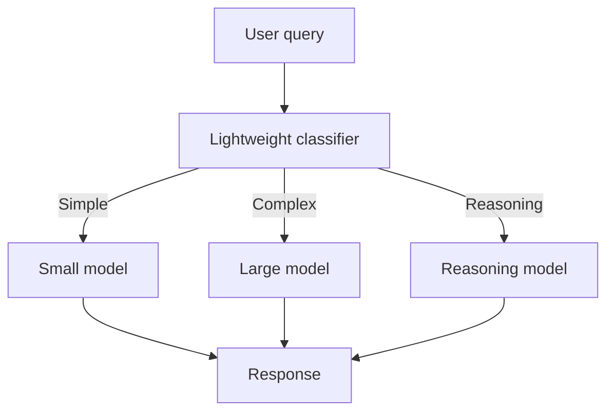

# Cost Engineering

> **Level:** INT · **Last verified:** 2026-10-20 · **Sources:** [OpenAI pricing](https://developers.openai.com/api/docs/pricing), [Claude pricing](https://platform.claude.com/docs/en/pricing)

## Why this matters

LLM costs scale linearly with usage and with prompt length. A naive implementation can cost 10–100× more than an optimized one for the same outcome. Cost engineering is the difference between a sustainable product and a budget crisis. The expert framing: LLM cost is *unusual* among infra costs — it's variable at the marginal-request level (unlike fixed infra), it's driven by *content* (token counts, not request counts), and it's mostly *controllable at design time* (model choice, caching, routing are architecture, not tuning). That last property is why cost work belongs in design reviews, not firefighting.

## Core concepts

### The six levers

| Lever | Savings | Effort | Where it applies |
|-------|---------|--------|------------------|
| **Prompt caching** | 50–90% on cached input | Trivial | Any stable-prefix workload |
| **Model routing** | 50–80% on simple queries | Medium | Heterogeneous query traffic |
| **Prompt compression** | 20–40% on long prompts | Medium | Long-context pipelines |
| **Smaller models for sub-tasks** | 60–90% on sub-tasks | Medium | Multi-stage agents |
| **Batch APIs** | 50% on async workloads | Low | Overnight/non-interactive |
| **Self-hosting steady state** | 70%+ at high volume | High | Predictable high-volume |

The expert reading of this table: the levers *compose multiplicatively*, and their order of application matters. Caching first (trivial, universal), then routing (biggest spread), then sub-task right-sizing. A team that routes 60% of traffic to Luna *and* caches the stable prefixes on the remaining 40% *and* batches the async third is stacking 3 levers; each is modest alone, ~10x+ combined.

### The routing pattern



A classifier (small fine-tuned model, embedding similarity, or even rules) routes queries by complexity.

The hidden economics of routing: the *classifier itself* costs money and latency, and its *mistakes* cost quality. A routing layer that costs $0.0001/query and misroutes 10% of complex queries to the cheap model is saving money on 90% of traffic and *losing quality* where it matters. The design pattern that works: route by *task type*, not by perceived difficulty — "summarization/extraction → cheap tier always; open-ended analysis → balanced; verifiable-hard (math/code with tests) → reasoning" is a stable mapping with few edge cases, while "is this query hard?" is a judgment call the classifier gets wrong in exactly the cases you care about. And measure the *misroute rate* with evals — routing is a system component with its own accuracy, not free money.

### The 2026 price ladder (per 1M tokens, input/output, verified 2026-10-20)

| Tier | OpenAI | Anthropic | Google |
|------|--------|-----------|--------|
| Cheap | GPT-6 Luna $0.10/$0.50 | Haiku 5.5 $0.10/$0.50 (≤100K) | 3.5 Flash-Lite $0.30/$2.50 |
| Balanced | GPT-6.1 Sol $2/$10 | Sonnet 5.5 $2/$10 | 3.8 Flash $0.75/$3.75 |
| Flagship | GPT-6 Astra $10/$50 | Opus 5.5 $4/$20 | 3.1 Pro $2/$12 |

The spread from cheap to flagship is ~100x on output — routing is your single biggest cost lever. Cached input runs ~10x cheaper across all three vendors; Batch APIs are 50% off everywhere. (Source: vendor pricing pages.)

Note what the ladder implies about *where* money goes: output tokens are 5x input on the balanced tier. A pipeline that generates 2K-token answers pays 10x more per output-token than per input-token — so *output* length is the cost lever most teams never touch. Capping `max_completion_tokens`, instructing brevity, structured outputs with tight schemas — these do for cost what caching does for input.

### Unit economics (the metric that matters)

Per-request cost is noise; **cost per successful outcome** is the number. An agent that costs $0.08/query at 95% task success has a unit cost of $0.084/success; one at $0.03 with 70% success costs $0.043/success — the "expensive" one is *cheaper* once retries, human-handoff costs, and user churn from failures count. This is why aggressive cost cutting *before* measuring quality-adjusted cost is a classic self-own: you optimize the numerator and tank the denominator. Track cost/success per workflow; optimize that.

### The cost attribution problem

When a multi-agent workflow burns 40K tokens, "which agent/route/user lost the money?" needs *per-span* cost attribution — OpenTelemetry spans with token counts and model ids (`03-observability-opentelemetry.md`), rolled up per workflow/user/tenant. Without attribution, cost engineering degenerates into global cost-cutting ("use Luna everywhere") instead of targeted fixes ("the research sub-agent reads 10x more context than it needs"). Attribution is what turns a cost dashboard into a cost *tool*.

## Code: token budgeting per request

```python
from openai import OpenAI
client = OpenAI()

class BudgetExceeded(Exception): pass

def call_with_budget(messages, model: str, max_input_tokens: int, max_output_tokens: int):
    input_tokens = sum(len(m["content"]) // 4 for m in messages)
    if input_tokens > max_input_tokens:
        raise BudgetExceeded(f"Input {input_tokens} > budget {max_input_tokens}")
    resp = client.chat.completions.create(
        model=model,
        messages=messages,
        max_completion_tokens=max_output_tokens,  # NOT max_tokens on GPT-5.x/6
    )
    PRICING = {"gpt-6.1-sol": (2.0, 10.0), "gpt-6-luna": (0.10, 0.50)}
    cost = (input_tokens / 1e6) * PRICING[model][0] + \
           (resp.usage.completion_tokens / 1e6) * PRICING[model][1]
    metrics.gauge("llm.request.cost_usd", cost, tags=[f"model:{model}"])
    return resp, cost
```

(Swap the `//4` estimator for a real tokenizer in production — `02-context-engineering/01-context-budgeting.md` covers how far off it is per domain.)

## Code: task-type routing (not difficulty routing)

```python
from openai import OpenAI
client = OpenAI()

ROUTE_RULES = {
    "summarize": "gpt-6-luna",
    "extract": "gpt-6-luna",
    "analyze": "gpt-6.1-sol",
    "verify": "gpt-6.1-sol",   # verifiable-hard → route up + verify with tests
}

def route(task_type: str) -> str:
    return ROUTE_RULES.get(task_type, "gpt-6.1-sol")
```

Task type comes from *your call site* (you know what you're asking for), which is why this beats a difficulty classifier: zero extra calls, zero misroute risk on the routing decision itself.

## Production concerns

- **Latency:** Routing via call-site task types adds zero latency; classifier-based routing adds a small call.
- **Cost:** Track cost per request, per user, per workflow — *and per successful outcome* (above). Alert on anomalies (baseline + 2σ); the quiet killer is the slow creep (corpus grew, prompts drifted longer) rather than the dramatic spike.
- **Failure modes:** (1) misrouting to small model degrades quality — watch evals per route; (2) cache-invalidation churn quietly un-does caching savings — track cached-token *rate*, not just absolute cost (`01-llm-calling/06-prompt-caching.md`); (3) batch-aping interactive traffic — the 50% discount tempts teams into fake-async UX, which costs more in product quality than it saves.
- **Security:** Cost telemetry should not log prompt content. Cost data joined with user IDs is itself sensitive (it reveals usage patterns of, e.g., power users); scope dashboards accordingly.

## Anti-patterns

- ❌ **Using one model for everything.** Always route — by task type from the call site.
- ❌ **No cost dashboards.** You can't optimize what you don't measure.
- ❌ **Ignoring prompt caching.** The lowest-hanging fruit.
- ❌ **Optimizing per-request cost instead of cost per successful outcome.** The denominator bites back.
- ❌ **Difficulty-classifier routing.** Misroutes concentrate exactly on the queries that matter; route by task type.
- ❌ **Uncapped output lengths.** Output tokens are the expensive class; `max_completion_tokens` is a one-line cost control.

## References

- [OpenAI Batch API](https://platform.openai.com/docs/guides/batch) — verified 2026-10-20
- [Anthropic prompt caching](https://docs.anthropic.com/en/docs/build-with-claude/prompt-caching) — verified 2026-10-20
- [LiteLLM (proxy + routing)](https://github.com/BerriAI/litellm) — verified 2026-10-20
