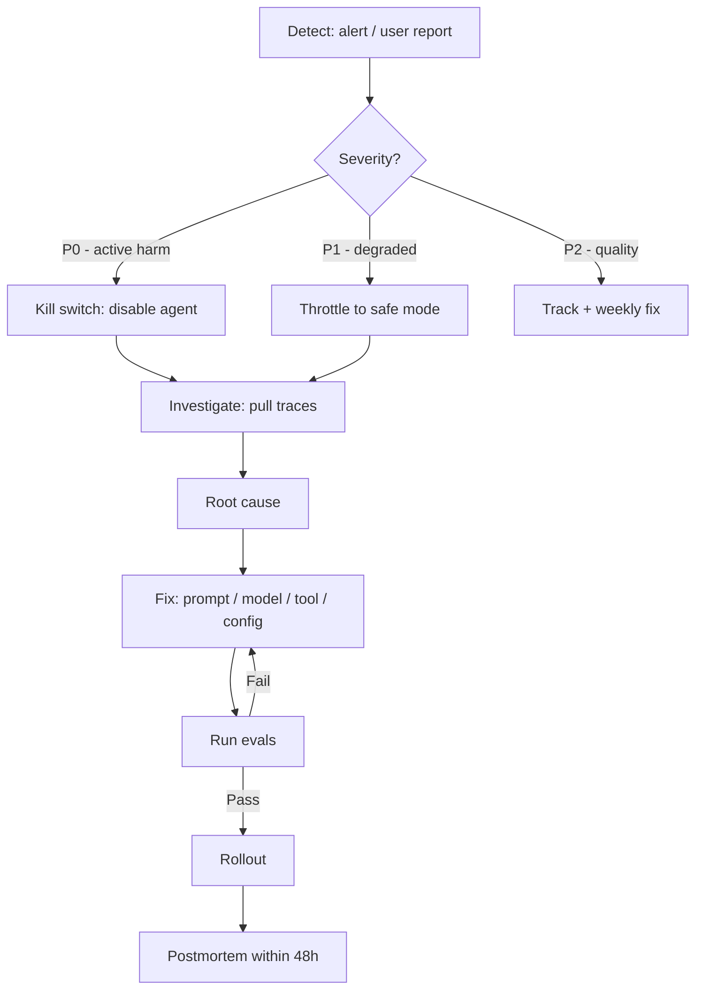

# Incident Response for Agents

> **Level:** ADV · **Last verified:** 2026-10-20

## Why this matters

When your agent misbehaves in production, the playbook is different from a traditional service incident. Agents produce wrong outputs at scale, cost money every minute, and the "fix" might be a prompt change with no rollback path. You need a specific IR flow. The expert framing: traditional IR assumes *containment = stop the bleeding* (kill the process, traffic returns to a previous good version). Agents break both halves: long-horizon agents keep running after you flip the switch (async work in flight), and "the damage" is *delivered content* (wrong answers shown to users, emails sent, files written) that a rollback doesn't un-show. Agent IR adds two verbs to the SRE playbook: *quarantine* and *recall*.

## Core concepts

### The agent IR flow



### The kill switch

Every production agent must have a kill switch that:

- Disables the agent in <1 minute.
- Falls back to a deterministic response or human queue.
- Doesn't require a deploy.

Implementation: feature flag (LaunchDarkly, Statsig, or homegrown).

### Quarantine — killing the switch isn't killing the agents

The kill switch stops *new* requests. It does nothing about:

- **Long-horizon runs in flight** — a 3-hour agent mid-task keeps running, keeps spending, keeps acting. Quarantine means revoking their *tool credentials* (the API keys the run's tools hold), not just preventing new runs — otherwise your kill switch has a multi-hour lag on exactly the runs with the most autonomy.
- **Scheduled/background work** — cron-triggered agents, queue workers; the kill switch must gate *them* too, which it won't if it only wraps the user-facing endpoint.
- **Sub-process engines** — Claude-Agent-SDK-style setups run a subprocess; killing the orchestrator orphans the engine. Kill process trees (`05-agents/02-anthropic-claude-agent-sdk.md`).

The runbook line: kill switch → *then* enumerate in-flight runs (you know them from your run registry — you have one, right? `06-multi-agent/04-long-horizon-tasks.md`) → revoke credentials / signal abort per run.

### Recall — the damage is delivered content

Rollback restores *code* to a good state; it doesn't unsend the email, un-write the file, or un-show the wrong answer. Recall is the discipline of finding and remediating already-delivered outputs:

- **Know what was delivered.** Every agent action with user-visible or external effect must be logged as an *artifact* (message id, email id, file path, API call) — this is the recall index. If actions aren't logged as retrievable artifacts, recall is impossible and "how many users saw the hallucinated price?" becomes archaeology.
- **Triage by harm.** Rank delivered outputs by severity (financial wrongness > factual wrongness to many users > wrongness to one user); recall the top of the list with follow-up ("correction: the price we quoted...").
- **External effects need compensation paths.** Sent emails can't be unsent — they can be corrected; payments can be reversed; published content edited. Each external system your agent touches should have its "undo story" documented *before* the incident, because discovering at 2am that the payment API has no void operation is its own incident.

### Blast radius per tenant

Multi-tenant agent systems add a scoping failure mode: one bad prompt version ships to *every tenant simultaneously*, and tenants with customized prompts/memory are affected differently. The mitigations: per-tenant feature flags (kill tenant-by-tenant, not all-or-nothing), tenant-scoped memory isolation (one tenant's poisoned memory must not be shared — `05-agents/06-agent-memory-patterns.md`), and incident comms templates that can go out per-tenant with accurate "were you affected" answers — which requires knowing which tenant got which version (config-version tracking on every request).

### Fix-under-incident discipline

The "fix" during an agent incident is often a prompt edit — the most seductive and dangerous move in the playbook, because prompt changes feel safe (it's just text) but have no rollback discipline by default. The rule that keeps this sane: prompt changes during an incident go through the *same* eval gate as normal changes, just compressed — golden-set run (minutes for a small set), then ship. The eval-less emergency prompt edit is how a P1 becomes two P1s: you "fixed" the visible symptom and broke three cases the golden set would have caught.

## Code: the kill switch

```python
import os
from flag_client import is_enabled  # your feature flag system

def agent_endpoint(query: str) -> str:
    if not is_enabled("agent_v2_enabled"):
        return "I'm undergoing maintenance. A human will follow up shortly."
    try:
        return run_agent(query)
    except Exception as e:
        metrics.increment("agent.error")
        return safe_fallback(query, e)
```

## Code: quarantine — revoking in-flight runs

```python
def quarantine_all_runs():
    for run in run_registry.list_active():          # requires a run registry
        run.revoke_credentials()                     # tools die even if loop lives
        run.request_abort()                          # cooperative stop
        metrics.increment("agent.quarantined_run", tags=[f"workflow:{run.workflow}"])
```

## Production concerns

- **Latency:** Kill switch check is <5ms.
- **Cost:** None. Quarantined runs stop burning tokens the moment credentials die.
- **Failure modes:** (1) kill switch itself fails — make it dead simple (a flag read, no dependencies on the agent stack); (2) run registry missing → quarantine is manual — build the registry *before* the incident; (3) recall index missing → delivered-harm scope unknowable; log artifacts as a data model, not log lines.
- **Security:** Access to flip the switch should be tightly controlled — but not *so* controlled that the on-call can't act at 2am. Tiered: on-call can kill/throttle; comms + recall require more sign-off.
- **Practice:** Game-day the flow quarterly: kill switch flips, in-flight runs get quarantined, a "delivered wrongness" is recalled. The first execution of a runbook should never be during a real incident.

## Anti-patterns

- ❌ **No kill switch.** One bad prompt ships to all users for hours.
- ❌ **Kill switch requires a deploy.** Too slow.
- ❌ **No postmortem.** Same incident repeats.
- ❌ **Kill without quarantine.** Long-horizon agents keep acting for hours after the switch.
- ❌ **No recall index.** Delivered harm becomes unmeasurable archaeology.
- ❌ **Eval-less emergency prompt edits.** The P1-multiplier.
- ❌ **Untested IR.** Game-day it; runbooks that have never been run don't run.

## References

- [Google SRE: Incident Response](https://sre.google/sre-book/incident-response/) — verified 2026-10-20
- [Statsig](https://www.statsig.com/) — verified 2026-10-20
- [LaunchDarkly](https://launchdarkly.com/) — verified 2026-10-20
