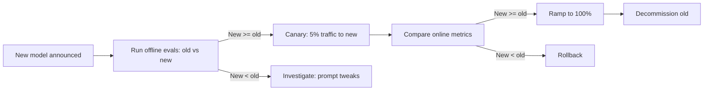

# Model Versioning & Migration

> **Level:** INT · **Last verified:** 2026-10-20 · **Sources:** [OpenAI model deprecations](https://developers.openai.com/api/docs/deprecations), [Claude model overview](https://platform.claude.com/docs/en/models/overview)

## Why this matters

Frontier model providers deprecate models every 6–12 months. Migrations are inevitable. A bad migration = silent quality regression = incident. A good migration = evals + canary + rollback. The expert framing: a model is a *dependency* — like a library version, except the changelog is vague, the behavior diffs are semantic (not API), and every upgrade re-rolls your prompts' effectiveness. The migration playbook is dependency management with evals as the test suite; teams that treat model IDs as config trivia and teams that treat them as versioned dependencies have very different migration experiences.

## Core concepts

### The migration flow



The step everyone under-weights is D's loop-back: new models are *differently* good, not uniformly better — a migration can lose on your specific golden set while being better on benchmarks, and the fix is prompt adaptation (the new model may need different instructions, different few-shots, different output-length guidance). Budget prompt-revision time into every migration; a straight model swap with untouched prompts is the naive version.

### The model config pattern

Never hardcode model names in code. Use a config:

```python
# config/models.yaml
default:
  chat: gpt-5
  reasoning: o3
  small: gpt-5-mini
  embedding: text-embedding-3-large
```

```python
# In code
import yaml
config = yaml.safe_load(open("config/models.yaml"))
model = config["default"]["chat"]
```

To migrate: update the YAML, deploy config-only.

The under-appreciated refinement: version the config *with the prompts that were tuned against it*. A model change and a prompt change shipping separately is the classic silent-regression setup — prompt v12 was tuned on model vN; on model vN+1 its behavior shifts; nobody connects the two deploys two weeks apart. Model config + prompt templates + eval thresholds are one *behavioral version*; deploy them as a unit.

### Alias vs snapshot — the reproducibility dial

- **Rolling aliases** (`gpt-6.1-sol`) update silently — you inherit fixes and changes without noticing. Good for consumer apps (stay current), terrible for reproducibility (a benchmark you ran last month may not reproduce).
- **Dated snapshots** (`...-2026-09-29` suffixes; Anthropic exposes dated aliases too) pin exact weights. Good for evals, judges, regulated outputs, and anything where "same input must give same-ish output across months."

The expert policy: **snapshot where you measure, alias where you serve.** Judges and eval baselines: pinned snapshots — your ruler must not move (`07-evals/02-llm-as-judge.md`). Production traffic: aliases — you inherit fixes. And when an alias quietly updates underneath you, your *canary metrics* are what notice — which is why "we serve the alias" is not a reason to skip monitoring, it's a reason for always-on drift detection.

### Deprecation timelines as design input

Providers publish deprecation windows (typically months). The operational reality: deprecations arrive on *their* schedule, not yours, and always cluster with other changes. The prepared posture: run the full eval suite against "next-gen candidate" models *periodically* (quarterly), not when the deprecation email arrives — then the forced migration is a config flip you've already validated, not a project. Teams caught by deprecation deadlines are teams that didn't rehearse; the rehearsal *is* the migration playbook, minus the time pressure.

### Tokenizer drift — the invisible breakage

Model changes often bring tokenizer changes: the *same text* is a different number of tokens, so everything downstream of token counts shifts — context budgets (your 30K-token history guard now overflows at a different string length), prompt-cache breakpoints (prefix token counts move; cache-hit patterns change), and cost models (per-token pricing × new token counts). Post-migration, verify: token-count guards still trip where expected, cache-hit rates are unchanged, cost per request within band. These are the migrations that "pass evals" and still page finance a week later.

## Code: side-by-side comparison

```python
def compare_models(query: str, old: str, new: str):
    out_old = call_model(old, query)
    out_new = call_model(new, query)
    judge = call_model("gpt-5", f"Which is better for query '{query}'?\nA: {out_old}\nB: {new}\nReply 'A' or 'B' if A is better, 'B' if B is better.")
    return {"old": out_old, "new": out_new, "judge": judge}
```

## Code: canary with feature flag

```python
def call_chat(query: str) -> str:
    if is_enabled("use_gpt_5_canary", default=False):
        return call_model(MODELS["chat"], query)
    return call_model(previous_alias, query)  # dated snapshot, e.g. ...-2026-09-29
```

## Production concerns

- **Latency:** No additional latency. (But: model swaps change latency *profiles* — different TTFT/TPS tiers; verify the new model meets the SLO, not just the eval score — `02-latency-slos.md`.)
- **Cost:** Side-by-side evals double cost temporarily. Budget it — and budget the *price* difference: migrations often move price tiers; a new model at 2x price with 5% quality gain needs the unit-economics check (`01-cost-engineering.md`).
- **Alias vs snapshot:** rolling aliases update silently — pin dated snapshots anywhere reproducibility matters, and alias everywhere else so you inherit fixes.
- **Failure modes:** (1) different tokenizers — token counts shift (above); (2) output-format drift — a model that used to emit clean JSON now adds preamble; structured outputs and schema validation are the immunization (`01-llm-calling/04-structured-outputs.md`); (3) *judge migration mixing* — comparing old-model outputs judged by a new-model judge confounds two changes; change one variable at a time.
- **Security:** New models may have different data policies (e.g., new vendor). Review DPA — data residency, training-on-your-data terms, retention. A migration is a *data-flow change*; route it through the same review as a new vendor integration.

## Anti-patterns

- ❌ **Hardcoded model names in code.** Makes migration a code change.
- ❌ **Big-bang migration.** Always canary.
- ❌ **No rollback plan.** Always have one.
- ❌ **Model swap without prompt pass.** New models are differently good; adapt prompts.
- ❌ **Separate deploys of model and prompt changes.** They're one behavioral version; ship them together.
- ❌ **Alias everywhere, including judges/evals.** Your ruler must be a snapshot.
- ❌ **Waiting for the deprecation email.** Rehearse quarterly; forced migrations shouldn't be projects.

## References

- [OpenAI: Model deprecations](https://developers.openai.com/api/docs/deprecations) — verified 2026-10-20
- [Anthropic: Model versions](https://docs.anthropic.com/en/docs/about-claude/models) — verified 2026-10-20
