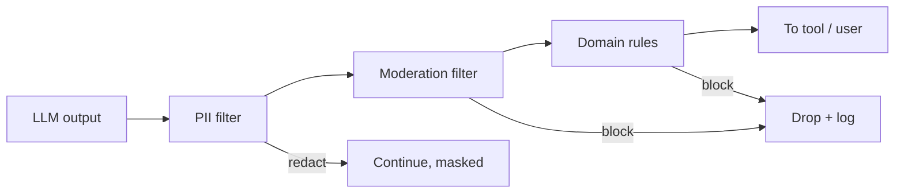

# Output Filtering

> **Level:** INT · **Last verified:** 2026-10-20 · **Sources:** [OpenAI moderation](https://developers.openai.com/api/docs/guides/moderation), [Microsoft Presidio](https://github.com/microsoft/presidio)

## Why this matters

Even with perfect input filtering, models produce harmful outputs: PII leaks, code with security bugs, toxic content, prompt-injection payloads in tool calls. Output filtering is your last line of defense before the user (or the tool) sees the output. The expert framing: an output filter is a *policy enforcement point* — and the two questions that decide whether it works are *where* it sits (before the human? before the tool? after the tool?) and *what happens on failure* (block, redact, degrade, or pass-through-with-flag). A filter without a designed failure action just moves the incident downstream.

## Core concepts

### Three filter layers

| Layer | What | Example | Failure action |
|-------|------|---------|----------------|
| **PII redaction** | Mask SSNs, emails, phone numbers | `ssn_detector.py` | Redact (not block) — the response is still useful |
| **Content moderation** | Block hate, violence, sexual content | OpenAI moderation API, Azure Content Safety | Block + safe fallback message |
| **Domain rules** | Block known-bad patterns for your app | No URLs in response, no SQL keywords | Block + log for review |

The failure-action column is the expert addition: redaction *repairs* the output (PII masking keeps the answer usable), moderation *replaces* it (a blocked response needs its designed fallback — the generic "I can't help with that" is itself a UX decision), domain rules *intercept* (the SQL keyword in tool args should reject the *call*, not the sentence). Teams that run all three with "block everything" as the only action produce brittle systems that product then fights.

### The pipeline



### The two audiences problem

"Output" isn't one thing in an agent system: the *text shown to the user* and the *arguments passed to tools* have different threat surfaces. User-facing output needs PII/moderation (human harm); tool arguments need domain rules and schema validation (machine harm — a URL arg to `fetch_url` is an exfiltration channel, a SQL arg is an injection payload). Filter both, with *different* rule sets — filtering one audience's risks with the other's rules produces false-positive noise in both directions. The most common production gap: filtering the visible response but passing tool-call arguments straight through.

### Streaming: the race you can't win naively

Note both filters run on **completed text** — with streaming, tokens reach the user before a mid-stream filter can act. Filter at the buffer boundary or gate streams behind a first-chunk check.

The honest options, in increasing safety order:

1. **Sentence-boundary buffering** — hold back each sentence until its filter verdict, then release. Adds one sentence of latency (~300-800ms); a blocked sentence can be replaced mid-stream. The production default for consumer UX.
2. **First-chunk gating** — filter chunk 1 hard, trust the model's momentum. Cheap, catches most policy breaks (violations rarely start clean), not a guarantee.
3. **No streaming on risky paths** — for high-stakes outputs (legal, medical), buffer fully. Latency is the cost of the guarantee.

What doesn't work: "we'll filter the final text for the log." The user already saw the tokens; the filter is forensics at that point, not defense.

## Code: PII redaction

```python
import re

PII_PATTERNS = {
    "ssn": (r"\b\d{3}-\d{2}-\d{4}\b", "[SSN REDACTED]"),
    "email": (r"\b[\w.-]+@[\w.-]+\.\w+\b", "[EMAIL REDACTED]"),
    "phone": (r"\b\+?\d{1,3}?[-.\s]?\(?\d{3}\)?[-.\s]?\d{3}[-.\s]?\d{4}\b", "[PHONE REDACTED]"),
    "credit_card": (r"\b(?:\d[ -]*?){13,16}\b", "[CC REDACTED]"),
}

def redact_pii(text: str) -> tuple[str, list[str]]:
    found = []
    for name, (pat, repl) in PII_PATTERNS.items():
        if re.search(pat, text):
            found.append(name)
            text = re.sub(pat, repl, text)
    return text, found
```

## Code: moderation via OpenAI

```python
from openai import OpenAI
client = OpenAI()

def moderate(text: str) -> tuple[bool, list[str]]:
    resp = client.moderations.create(input=text, model="omni-moderation-latest")
    result = resp.results[0]
    if result.flagged:
        return False, [k for k, v in result.categories.model_dump().items() if v]
    return True, []
```

## Code: domain rules

```python
def domain_filter(text: str, ctx: dict) -> tuple[bool, str | None]:
    # No URLs in customer-facing responses
    if ctx.get("audience") == "customer" and re.search(r"https?://", text):
        return False, "url_in_customer_response"
    # No SQL keywords in tool args
    if ctx.get("target") == "sql_tool":
        if re.search(r"\b(drop|delete|truncate|alter)\b", text, re.IGNORECASE):
            return False, "destructive_sql"
    return True, None
```

### Robust PII: Presidio over regex

The regex redactor above is a demo. In production use [Presidio](https://github.com/microsoft/presidio) — named-entity recognition plus checksum-verified detectors for phone/email/credit-card/IDs, with a simple API:

```python
from presidio_analyzer import AnalyzerEngine
from presidio_anonymizer import AnonymizerEngine

analyzer, anonymizer = AnalyzerEngine(), AnonymizerEngine()
result = analyzer.analyze(text=llm_output, language="en")
clean = anonymizer.anonymize(text=llm_output, analyzer_results=result)
print(clean.text)   # "<PHONE_NUMBER>" replaces the literal number
```

Why Presidio wins, concretely: regex redaction has asymmetric errors that hurt — false negatives (a phone formatted `+44 20 7946 0958` vs your US-only regex) leak the exact PII you existed to catch, while false positives (redacting every 10-digit number, including order IDs users legitimately need) destroy utility. NER-based detection understands context ("call me at..." before the digits); checksum validators (credit card Luhn) confirm before masking. The additional nuance for LLM outputs specifically: models *reformat* — they'll output a phone number with spacing your regex never saw. Format-robust detection is the whole game.

## Production concerns

- **Latency:** PII + regex = <5ms. Moderation API = 100–300ms (batch it with your generation call pattern; run parallel to, not serially after, other post-processing where possible).
- **Cost:** Moderation API is free for OpenAI; self-hosted alternatives exist.
- **Failure modes:** (1) false positives block legit content — measure the block rate, alert on spikes, and give product a visible path to report over-blocking (a filter product can't see degrades into a filter product quietly disables); (2) false negatives — red-team the filter itself (`02-garak-pyrit.md`): your filters are attack surface, not just defense; (3) streaming races (above); (4) filter *order* bugs — redacting PII before moderation changes what moderation sees; keep the order deterministic and tested.
- **Security:** Filter logs may contain blocked content; encrypt. Blocked-content logs are a concentrated store of the *worst* outputs plus user data — the most sensitive log you have; strictest retention policy in the system.

## Anti-patterns

- ❌ **No output filtering.** Trust the model → leak PII / ship toxic content.
- ❌ **Filtering only some outputs.** All outputs — including tool-call arguments, the usual blind spot.
- ❌ **Treating moderation API as ground truth.** Audit and tune.
- ❌ **Blocking as the only failure action.** Redact when repairable, replace when blocked, intercept tool calls at the tool.
- ❌ **Streaming with no strategy.** Sentence buffering or first-chunk gating; "filter later" is forensics, not defense.
- ❌ **One rule set for both audiences.** User-facing text and tool args have different threat surfaces.

## References

- [OpenAI Moderation API](https://platform.openai.com/docs/guides/moderation) — verified 2026-10-20
- [Azure Content Safety](https://learn.microsoft.com/en-us/azure/ai-services/content-safety/) — verified 2026-10-20
- [Presidio (PII redaction)](https://github.com/microsoft/presidio) — verified 2026-10-20
