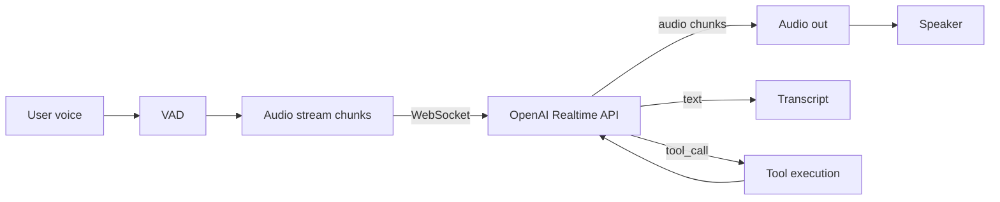

# OpenAI Realtime API

> **Level:** ADV · **Last verified:** 2026-10-20 · **Sources:** [OpenAI Realtime API](https://developers.openai.com/api/docs/realtime)

## Why this matters

Real-time voice changes the UX of AI. Sub-second conversational agents unlock entirely new product categories: voice customer support, ambient scribes, live coaching. The Realtime API is the cleanest path in 2026. The expert framing: speech-to-speech is a *different architecture*, not "chat with TTS bolted on" — the model perceives and generates audio natively, which is what makes sub-second response possible (no ASR→LLM→TTS pipeline to serialize) and what makes prosody, interruption, and backchannel behavior feel human. Everything unusual about the API — event streams, session objects, buffer semantics — exists to serve that native-audio loop.

## Core concepts

### The architecture



### The pipeline you're replacing (and why native wins)

The classic voice pipeline is ASR → LLM → TTS, three models serialized: each adds its latency, each *discards* information (ASR strips prosody/tone; TTS invents it back). Total: 1.5-3s typical, and the model literally cannot hear that the user sounded annoyed. Speech-to-speech models consume audio tokens directly and emit audio tokens — one model, one pass, ~500-800ms, and the model *hears* tone: it can respond to hesitation, speed up when interrupted, match the user's energy. That perceptual richness is the product argument for realtime APIs beyond raw speed.

The trade you make: less *inspectability*. In the pipeline world you can read the transcript before it's spoken, filter it, branch on it. In native audio, the audio *is* the output — your text-level output filters (`10-safety/03-output-filtering.md`) don't see it until the transcript event. High-stakes voice deployments live with this tension via session configuration (restricted topics, tool-gated actions) rather than output filtering.

### Key concepts

- **Session** — one WebSocket connection = one conversation. The `session.update` event is your config surface: turn detection, voice, modalities, tools, temperature. One session, updated mid-conversation if needed.
- **Turns** — model listens, responds, listens again. The unit of billing and of context growth.
- **Interruption** — user interrupts model mid-speech; API cancels. The `input_audio_buffer.speech_started` event is your client-side signal to duck local playback (see `03-vad-and-interruption.md`).
- **Voice activity detection (VAD)** — server-side or client-side.
- **Function calls** — model can call tools mid-conversation. The conversational twist: while the tool runs, the model can *fill* — a spoken "let me check that for you" before the tool result arrives. Design tool UX for voice: a 5-second silent tool call feels broken; either let the model backfill audio or emit a holding response.

### Latency budget

| Stage | Target |
|-------|--------|
| User stops speaking → VAD detects | 200ms |
| VAD → first audio token from model | 400ms |
| First audio token → user hears | 100ms |
| **Total response latency** | **~700ms** |

Above 1s feels broken. Below 500ms feels magical.

The budget's lesson: *VAD time is a third of it*. The model's 400ms is mostly fixed; the tunable 200ms is turn detection (`03-vad-and-interruption.md`'s silence_duration_ms). This is why voice teams obsess over VAD tuning — it's the largest *controllable* term in perceived responsiveness.

## Code: minimal Realtime client

```python
import asyncio, json, websockets
import base64

async def realtime_conversation():
    url = "wss://api.openai.com/v1/realtime?model=gpt-realtime-2.1"
    headers = {"Authorization": "Bearer YOUR_API_KEY", "OpenAI-Beta": "realtime=v1"}

    async with websockets.connect(url, extra_headers=headers) as ws:
        # Configure session
        await ws.send(json.dumps({
            "type": "session.update",
            "session": {
                "turn_detection": {"type": "server_vad", "threshold": 0.5, "silence_duration_ms": 500},
                "voice": "verse",
                "modalities": ["text", "audio"],
            }
        }))

        # Send audio (from mic)
        async def send_audio():
            async for chunk in mic_audio_stream():
                await ws.send(json.dumps({
                    "type": "input_audio_buffer.append",
                    "audio": base64.b64encode(chunk).decode(),
                }))

        # Receive responses
        async def receive():
            async for msg in ws:
                event = json.loads(msg)
                if event["type"] == "response.audio.delta":
                    speaker.play(base64.b64decode(event["delta"]))
                elif event["type"] == "input_audio_buffer.speech_started":  # barge-in
                    await ws.send(json.dumps({"type": "response.cancel"}))
                    speaker.stop()  # user interrupted

        await asyncio.gather(send_audio(), receive())
```

### Transports

WebSocket is the server-to-server default. **WebRTC** is the right choice for browsers and mobile (client-side audio, NAT traversal); **SIP/telephony** connects the phone network. All three speak the same session protocol.

The transport decision is really an *audio-path* decision: WebRTC puts audio capture/playback, echo cancellation, and jitter buffering in the browser's stack (battle-tested, free); WebSocket over your own server means *you* own mic capture, AEC, and jitter handling client-side. For server-side audio sources (telephony gateways, files, synthesized audio), WebSocket is natural; for human users on devices, WebRTC saves you from reimplementing half a softphone.

## Production concerns

- **Latency:** WebSocket keepalive; reuse connection. Session *resumption* is the production pattern for dropped connections — reconnect and continue the conversation rather than losing context.
- **Cost:** Billed per audio token, not per minute: gpt-realtime-2.1 is $32/1M audio input ($0.40 cached) and $64/1M audio output — roughly $0.05/min all-in with caching working; gpt-realtime-2.1-mini ($10/$20) lands near $0.016/min. Cached audio input is ~80x cheaper than fresh — keep the session prefix stable (same session config, same voice, append-only audio).
- **Failure modes:** (1) network jitter causes audio gaps — buffer client-side; (2) *half-duplex collapse* — if your client doesn't duck playback on speech_started, the mic hears the model and triggers spurious interruptions (AEC, `03-vad-and-interruption.md`); (3) session-configuration drift — a session resumed with different config invalidates the cached prefix (silently repricing you).
- **Security:** Don't log audio; it's PII. Beyond logging: realtime sessions with *tools* mean spoken requests trigger real actions — the authz boundary is the tool layer (`04-tools-and-mcp/01-function-calling-across-providers.md`), because there's no text output filter in the loop to save you. Voice is also an *authentication* surface — "hey, cancel my account" spoken by someone else in the room; voice-activity products need a separate identity story (session-bound auth, confirmation for destructive actions).

## Anti-patterns

- ❌ **Server-side VAD with silence_duration_ms > 1000.** Feels sluggish.
- ❌ **No interruption handling.** Model keeps talking over user.
- ❌ **Logging raw audio.** Major PII risk.
- ❌ **Text-pipeline habits: waiting for "final" responses.** Realtime is event-stream-native; handle deltas or your UX regresses to batch.
- ❌ **Silent tool calls.** Voice UX needs filled waiting time — enable or design backfill.
- ❌ **Destructive actions without spoken confirmation.** No text filter catches a spoken mistake.

## References

- [OpenAI Realtime API](https://developers.openai.com/api/docs/realtime) — verified 2026-10-20
- [OpenAI Realtime API reference](https://platform.openai.com/docs/api-reference/realtime) — verified 2026-10-20
