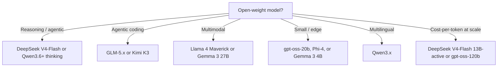

# Open-Weight Model Selection

> **Last verified:** 2026-10-20 · **Sources:** [vLLM model roster](https://vllm.ai/), [DeepSeek API changelog](https://api-docs.deepseek.com/updates)

## The 2026 lineup

| Family | Sizes | Strengths | License |
|--------|-------|-----------|---------|
| Qwen 3.x (3.5–3.8) | small → 235B+ MoE | Best all-round open line: reasoning, coder, embedding, reranker variants | Apache 2.0 (most) |
| DeepSeek V4 | V4-Flash 284B (13B active), V4-Pro 1.6T | Reasoning + agentic; extremely cheap to serve (MLA) | MIT |
| GLM-5.x | 5 → 5.2 + Flash variants | Agentic/coding SOTA among open weights | MIT |
| Kimi K2.x → K3 | 1T-class MoE (32–50B active) | Long context, agentic tool use | Modified MIT |
| gpt-oss (OpenAI) | 120B (5.1B active), 20B (3.6B active) | OpenAI-trained, Apache-2.0, ships MXFP4-quantized | Apache 2.0 |
| Llama 4 | Scout, Maverick (17B active); Behemoth preview-only | Multimodal MoE, broad ecosystem | Llama 4 Community License (700M-MAU clause) |
| Gemma 3 / 4 | 1B → 27B+ | Google-backed, multimodal, edge-friendly | Gemma license |
| Mistral | Small 4, Medium 3.5, Large 3 | Mature, EU-based | Apache 2.0 (Small); research/commercial varies (Large) |
| Phi-4 | 14B + variants | Microsoft, small-model reasoning | MIT |

## Decision tree

## Default recommendation

- **General purpose**: Qwen3.x (largest size that fits your GPUs).
- **Reasoning/agentic**: DeepSeek V4-Flash; GLM-5.x if coding-heavy.
- **Cheap / small**: gpt-oss-20b (Apache-2.0) or Gemma 3 4B.
- **Multilingual**: Qwen3.x.
- **Don't default to Llama anymore**: since April 2025 the open-weight center of gravity moved to Qwen/DeepSeek/GLM/gpt-oss; evaluate Llama 4 on merit per case, and note Behemoth never shipped beyond preview.

## References

- [vLLM supported models roster](https://vllm.ai/) — verified 2026-10-20
- [DeepSeek V4 changelog](https://api-docs.deepseek.com/updates) — verified 2026-10-20
- [Qwen on Hugging Face](https://huggingface.co/Qwen) — verified 2026-10-20
- [gpt-oss](https://github.com/openai/gpt-oss) — verified 2026-10-20
