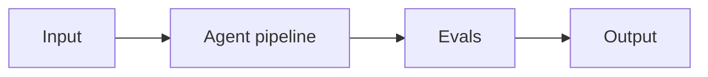

# Project 14: Multimodal Customer Support Agent

> **Difficulty:** ADV · **Skill demonstrated:** Multimodal, RAG, escalation · **Status:** 🚧 Skeleton

## Problem

Build a customer support agent that handles text + image (screenshots) + audio inputs, with RAG over docs and human escalation.

## Architecture



Multimodal input -> triage -> RAG (docs + screenshots) -> Claude Sonnet 5.5 with vision -> escalate if confidence < threshold.

## Stack

- Python
- anthropic
- qdrant
- FastAPI
- React

## Getting started

```bash
# Install
make install

# Run
make run

# Run tests
make test

# Run evals
make eval
```

## Evals

This project ships with an eval harness (runner + a golden-dataset placeholder to fill with real cases). Eval metrics:

- `resolution_rate`
- `escalation_rate`
- `csat`
- `cost_per_ticket`

The `make eval` command runs the eval suite and prints a report. Once the golden set is real, wire it into CI and gate merges on it.

## Project structure

```text
14-multimodal-customer-support-agent/
├── README.md              # this file
├── pyproject.toml         # dependencies
├── Makefile               # install/run/test/eval targets
├── DEPLOYMENT.md          # how to deploy
├── src/
│   └── __init__.py
├── tests/
│   └── test_smoke.py
├── evals/
│   ├── golden.jsonl       # golden dataset
│   ├── eval_runner.py     # eval runner
│   └── README.md
└── .gitignore
```

## What this project demonstrates

This is a portfolio project. When complete, it should clearly demonstrate:
- Multimodal, RAG, escalation
- Production concerns: cost, latency, failure modes, security
- Evals: golden dataset + automated runner
- Tests: at least unit + integration
- Deployment: Dockerized, one-command deploy

## Next steps

See `DEPLOYMENT.md` for deployment instructions and `evals/README.md` for the eval methodology.
